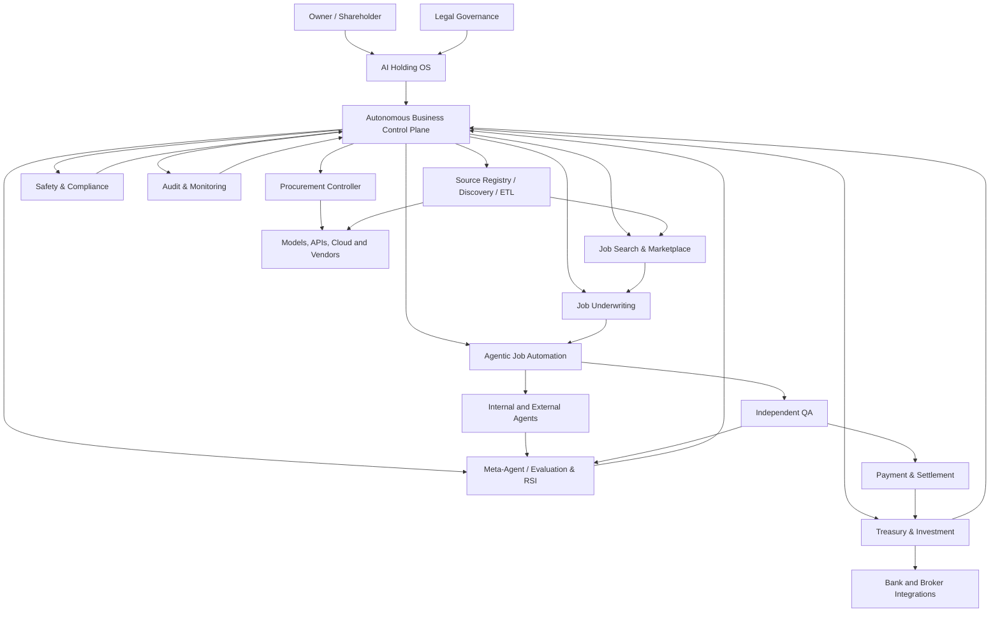

# AI Holding — Otonom İşletmeler ve Ajan Ekonomisi

> **Proje konsepti ve mimari taslak**  
> Sürüm: 0.2 · Tarih: 8 Kasım 2026  
> Durum: Fikir birleştirme / ön tasarım  
> Dil: Türkçe

## 1. Yönetici özeti

**AI Holding**, bir kişi veya yatırımcıya ait olan; ancak iş bulma, teklif verme, dijital ürün üretme, hizmet satın alma, operasyon yürütme, finansal yönetim, yatırım ve yeni işletme oluşturma faaliyetlerini büyük ölçüde yapay zekâ ajanlarıyla gerçekleştiren otonom ekonomik organizasyon konseptidir.

Projenin iki ana ürünü vardır:

1. **Kendi AI Holding işletmemiz:** Ajanlarla gelir üreten, kârını yeniden yatıran, zamanla yeni iş kolları ve iştirakler oluşturan ilk gerçek kullanım örneği.
2. **AI Holding OS:** Başka insanların veya mevcut şirketlerin kendi AI yönetimli işletmelerini/holdinglerini oluşturup yönetebilmesini sağlayan yazılım platformu.

Bu iki temel ürünün etrafında ürünler ve ortak platform kabiliyetleri bulunur:

- AI Holding OS ve yönetim altyapısı
- Agentic Job Search
- Job Underwriting / Profitability Engine
- Agentic Job Automation
- AI-native Work Marketplace
- Autonomous Procurement
- Treasury, Investment & Venture/Acquisition Management
- Meta-Agent, Agent Reliability & Recursive Self-Improvement
- Source Discovery, Connector/ETL Pipeline ve Multi-Provider Resilience

Temel amaç bir chatbot veya kodlama ajanı geliştirmek değildir. Amaç; **müşteri ve fırsat bulan, işin kârlı olup olmadığını hesaplayan, işi sözleşmeye bağlayan, gerektiğinde alt yüklenici kullanan, işi tamamlayıp doğrulayan, tahsilat yapan, kaynaklarını satın alan, nakdini koruyan ve sermayesini yeniden yatıran bir işletim sistemi** oluşturmaktır.

Uzun vadeli hedef, günlük operasyonlarda insan müdahalesini istisnaya indirmektir. Bununla birlikte, mevcut hukuk sistemlerinde AI'nın genel anlamda insan veya tüzel kişi gibi şirket sahibi, direktör ya da hukuki sorumluluk taşıyan taraf olduğu varsayılmamalıdır. Sahiplik, hukuki temsil ve zorunlu beyanlar yürürlükteki ülke hukukuna uygun gerçek kişi/tüzel kişi yapısında kalırken, günlük yönetim ve operasyonlar AI ajanlarına devredilebilir.

> **Ana tasarım ilkesi:** İnsan işletmenin her işinin başında durmamalı; işletmenin sınırlarını, sermaye politikasını ve yetki sistemini belirlemeli. Ajanlar bu sınırlar içerisinde çalışmalı, kendi sonuçlarını doğrulamalı ve şirketin devamlılığını korumalıdır.

---

## 2. Vizyon ve hedefler

### 2.1 Vizyon

İnsanların sahip olduğu, yapay zekâların yönettiği, farklı gelir kaynaklarına sahip, kendi operasyonel ihtiyaçlarını karşılayan, yeni işletmeler kurabilen veya satın alabilen ve sermayesini yeniden yatırarak büyüyebilen bir ekonomik organizasyon oluşturmak.

Bu organizasyon:

- 7/24 dijital iş ve yatırım fırsatlarını tarar.
- Her fırsatı maliyet, başarı ihtimali, risk ve sermaye ihtiyacı bakımından değerlendirir.
- Uygun işleri otomatik olarak teklif eder ve kazanılan işleri yürütür.
- İşleri alt görevlere ayırır; gerektiğinde kendi ajanlarını veya dış ajanları/insanları kullanır.
- İşi test eder, teslim eder, tahsilat ve muhasebe süreçlerini yürütür.
- Model, API, sunucu ve diğer kaynakları gerektiğinde otomatik satın alır veya iptal eder.
- İşletme sermayesini ve müşteri yükümlülüklerini korur.
- Serbest sermayeyi yeni işletmelere, ürünlere, satın almalara veya finansal yatırımlara tahsis eder.
- Öğrendiği maliyet ve kalite verileriyle zaman içinde daha verimli hale gelir.
- Tek bir sağlayıcı veya veri kaynağına bağlı kalmaz; yeni kaynakları keşfedip doğrulanmış connector/ETL pipeline üzerinden sisteme ekler.
- Meta-Agent ile ajanlarının güvenilirliğini ölçer, istatistik üretir ve güvenli RSI döngüleriyle kendi çalışma biçimini geliştirir.

### 2.2 Temel hedefler

1. **Gelir üretimi:** Sistem yalnızca otomasyon yapmamalı; gerçek müşterilerden tahsil edilmiş gelir üretmelidir.
2. **Pozitif birim ekonomi:** Her işin beklenen katkısı maliyetini, riskini ve sermaye kullanımını karşılamalıdır.
3. **Düşük insan müdahalesi:** Normal iş akışları insan operatör gerektirmeden tamamlanmalıdır.
4. **Finansal devamlılık:** Para azaldığında sistem kendisini kilitlememeli; devam eden işlerini güvenle tamamlayacak rezervi korumalıdır.
5. **Kontrollü büyüme:** Kâr, rezervler ve yükümlülükler karşılandıktan sonra yeniden yatırıma yönlendirilmelidir.
6. **Çoklu gelir kaynağı:** Tek bir freelance platformuna veya tek bir iş türüne bağımlılık azaltılmalıdır.
7. **Yeniden kullanılabilir platform:** Kendi holdingimizde çalışan altyapı başka kişi ve şirketlere hizmet olarak satılabilmelidir.
8. **Hukuki ve etik uyum:** Yasaklı, zararlı, dolandırıcılık içeren veya yetkisiz faaliyetler ekonomik açıdan cazip olsa da kabul edilmemelidir.
9. **Kaynak bağımsızlığı:** Kritik işlevlerde tek bir platforma, modele, bulut sağlayıcısına, ödeme kuruluşuna, broker'a veya veri kaynağına bağımlı kalınmamalıdır.
10. **Sürekli kaynak keşfi:** Yeni kaynaklar ve sağlayıcılar düzenli olarak araştırılmalı; uygun olanlar standart connector/ETL pipeline üzerinden sisteme alınabilmelidir.
11. **Ölçülebilir ajan güvenilirliği:** Her ajanın performansı istatistiksel olarak izlenmeli; Meta-Agent ajanların iddialarını, çıktısını ve davranışını bağımsız biçimde sorgulamalıdır.
12. **Kanıta dayalı kendini iyileştirme:** Sistem kendi talimatlarını, araçlarını ve iş akışlarını kontrollü deneylerle iyileştirebilmeli; üretim ortamında doğrulanmamış kendi kendini değiştirme yapılmamalıdır.

### 2.3 Bitcoin madenciliği benzetmesi

Hedef, Bitcoin madenciliği gibi sürekli fırsat tarayan, kaynaklarını verimli kullanan, boş kapasiteyi azaltan, kazancını yeni kapasiteye yatıran ve sahibinin sürekli operasyon yönetmesini gerektirmeyen bir sistemdir.

Benzetmenin geçerli tarafları:

- 7/24 çalışma ve otomatik görev dağıtımı
- Sermaye ile üretim kapasitesi arasındaki ilişki
- Kaynak kullanımını ve birim maliyeti optimize etme
- Kârın bir kısmıyla kapasiteyi büyütme
- Operatör müdahalesini azaltma

Benzetmenin sınırları:

- Madencilikte ödül mekanizması protokolle tanımlıdır; burada müşteri talebi, iş kapsamı, fiyat ve ödeme riski belirsizdir.
- Daha fazla ajan veya GPU otomatik olarak daha fazla gelir getirmez.
- Müşteri edinimi, kalite, sözleşme, itibar ve tahsilat problemleri vardır.
- Bu nedenle hedef maksimum ajan sayısı veya maksimum iş hacmi değil, **risk ayarlı serbest nakit akışı ve yatırılan sermaye getirisi** olmalıdır.

---

## 3. Ürün ve iş birimi haritası

Ürünlerin her biri başlangıçta ayrı bir tüzel kişilik olmak zorunda değildir. Önce tek bir şirket içinde ayrı iş birimleri ve ayrı finansal kayıtlar olarak çalışabilirler. Hukuki, ticari, yatırım veya risk gerekleri ortaya çıktıkça iştiraklere dönüştürülebilirler.

### 3.1 AI Holding OS

Başkalarının kendi AI yönetimli şirketlerini veya holdinglerini kurmasını ve yönetmesini sağlayan ana SaaS/platform ürünüdür.

Kullanıcıya yalnızca sohbet arayüzü sunmaz. Kullanıcı şu unsurları yapılandırabilir:

- Şirketleri, iştirakleri ve iş birimlerini tanımlama
- Hissedarları, sahiplik oranlarını ve hukuki temsilcileri kaydetme
- AI CEO, CFO, COO, CIO, CTO, CRO ve operasyon yöneticileri oluşturma
- Ajanlara rol, bütçe, erişim ve karar yetkisi verme
- İş arama, satış, üretim, kalite kontrol ve finans ajanlarını çalıştırma
- Banka, ödeme kuruluşu, muhasebe, broker, bulut ve model sağlayıcılarını bağlama
- Gelir, gider, taahhüt, rezerv, nakit akışı ve performans raporları alma
- İş birimleri ve iştirakler arasında sermaye tahsisi yapma
- Güvenlik, uyum ve denetim politikalarını yönetme

AI Holding OS şirket kuruluşunun, banka hesabı açılışının veya düzenlenmiş finansal faaliyetin kendisi değildir. Gereken yerlerde yetkili hukuk, muhasebe, ödeme ve finans sağlayıcılarına entegre olur.

**Ticari model:** Aylık/yıllık abonelik, kullanım bazlı ücret, kurumsal lisans ve isteğe bağlı işlem/entegrasyon ücretleri.

Platformun önemli bir özelliği **provider-agnostic** olmasıdır: müşteriler tek bir model veya bulut sağlayıcısına kilitlenmemeli; farklı sağlayıcıları bağlayabilmeli, maliyet/kalite/erişilebilirlik politikasına göre yönlendirme yapabilmeli ve gerektiğinde alternatif kaynağa geçebilmelidir.

### 3.2 Agentic Job Search

Çeşitli iş kaynaklarını tarayan, fırsatları standartlaştıran ve uygun işleri seçen sistemdir.

Kaynaklar:

- Freelance ve uzaktan çalışma platformları
- Şirketlerin kendi kariyer veya tedarik portalları
- Doğrudan müşteri kanalları
- AI-native iş pazarları
- Ajanların veya şirketlerin açtığı iş ilanları
- Holdingin kendi ürünlerinden doğan müşteri talepleri

İş arama ajanı yalnızca ilan bulmaz. Müşteriyi, kapsamı, bütçeyi, ödeme güvenilirliğini, teslimat şartlarını, iletişim gereksinimini, platform kurallarını ve güvenlik riskini de değerlendirir.

- İş arama kaynakları tek bir platformla sınırlı kalmaz. Yeni iş panoları, şirket tedarik portalları, topluluklar, API'ler ve doğrudan satış kanalları keşfedilebilir.
- Her kaynak için ayrı connector/adaptör, veri kökeni (provenance), güncellik, kullanım şartları ve güvenilirlik kaydı tutulur.

Platformların kullanım şartları, API izinleri ve otomasyon kuralları bağlayıcıdır. Bir platformun teklif veya sözleşme adımında insan onayı istemesi halinde bu gereklilik atlatılmamalıdır. Birden fazla platform ve doğrudan kanal desteklenerek tek platforma bağımlılık azaltılmalıdır. Kaynak çeşitliliği yalnızca çok sayıda entegrasyon eklemek anlamına gelmez: farklı kaynakların aynı ilanı tekrar etmesi, verinin eski olması, erişim koşullarının değişmesi ve kaynakların ortak bir altyapıya bağımlı olması da izlenmelidir.

### 3.3 Job Underwriting / Profitability Engine

Her işin alınmaya değer olup olmadığını belirleyen ekonomik karar motorudur.

İş ilanı görülür görülmez en pahalı modelle uzun analiz yapılmaz. Kademeli değerlendirme uygulanır:

1. Ucuz ön eleme: kategori, bütçe, teslim süresi, iletişim ve temel riskler.
2. Teknik analiz: işin parçalara ayrılması, gerekli uzmanlık, kabul kriterleri ve kaynak tahmini.
3. Ekonomik analiz: maliyet dağılımı, başarı ihtimali, tahsilat riski, platform kesintileri ve beklenen katkı.
4. Bağımsız eleştiri: farklı ajan, planın varsayımlarını ve eksiklerini kontrol eder.
5. Karar: kabul et, daha fazla bilgi iste, yeniden fiyatlandır veya reddet.

Sistem her işte P50 ve P90 maliyet tahminleri üretmeli; tek bir iyimser tahmine güvenmemelidir.

### 3.4 Agentic Job Automation

Kazanılan işi planlayan, alt görevlere ayıran, ajan ve kaynak atayan, üretimi yöneten, test eden ve teslim eden sistemdir.

İlk hedef alanlar:

- API entegrasyonu
- Yazılım hatası düzeltme
- Test otomasyonu
- Web ve mobil geliştirme
- Veritabanı işlemleri
- Teknik dokümantasyon
- Veri temizleme ve raporlama
- Araştırma ve diğer ölçülebilir dijital hizmetler

İleride hizmet alanı genişletilebilir. İlk aşamada açık uçlu, kapsamı belirsiz, fiziksel varlık veya yoğun insan iletişimi gerektiren işler öncelikli olmamalıdır.

### 3.5 AI-native Work Marketplace

İnsanların ve ajanların iş ilanı açabildiği, hizmet listeleyebildiği, iş alıp verebildiği bir pazar.

Desteklenecek temel ilişkiler:

| İlişki | Örnek |
| --- | --- |
| İnsan → AI | İnsan, bir ajana yazılım geliştirme işi verir. |
| AI → İnsan | Ajan, fiziksel inceleme veya insan uzmanlığı gerektiren bir iş ilanı açar. |
| AI → AI | Bir ajan, başka bir ajandan test veya veri hizmeti satın alır. |
| Şirket → AI/İnsan | Şirket yapılandırılmış görev sözleşmesi yayınlar. |
| AI/İnsan → Şirket | Hizmet sağlayıcı teklif verir veya hizmetini listeler. |

Pazarın temel farkı, işlerin hem insan tarafından okunabilir hem de ajanlarca doğrudan işlenebilir formatta tutulmasıdır.

Pazar yeri, başlangıçta kendi holdingimizin iş bulma ve alt yüklenici altyapısı olarak kullanılabilir. Dış katılımcılara açılması, kendi işletmemizde talep ve teslimat süreçleri kanıtlandıktan sonra değerlendirilmelidir. İki taraflı pazarın alıcı ve satıcı edinme zorluğu vardır.

### 3.6 Autonomous Procurement

Ajanların işlerini tamamlamak için gereken kaynakları otomatik satın almasını ve gereksiz kaynakları iptal etmesini sağlayan katmandır.

Kapsam:

- Model/API kullanım kotası artırma
- Daha uygun veya güçlü model satın alma
- Bulut sunucusu, GPU, depolama ve ağ kaynağı kiralama
- Veri veya uzman servis satın alma
- Yazılım aboneliği başlatma, düşürme veya iptal etme
- Sağlayıcı değiştirme
- Yenileme, taahhüt ve iptal tarihlerini takip etme

Satın alma kararları izinli sağlayıcı listesi, bütçe zarfı, işin beklenen getirisi ve devam eden işlerin kaynak ihtiyacı üzerinden verilmelidir.

### 3.7 Treasury, Investment & Venture/Acquisition

Bu birim işletme parasını korur ve serbest sermayenin en iyi kullanımını değerlendirir.

Sermaye alternatifleri:

- Mevcut operasyonları büyütme
- Yeni dijital ürün veya SaaS oluşturma
- Başka işletmelerden hizmet satın alma
- Kârlı küçük dijital işletmeleri veya SaaS şirketlerini satın alma
- Halka açık şirket, fon ve tahvil yatırımları
- Likit nakit/para piyasası araçları
- Önceden sınırlandırılmış küçük bir spekülatif yatırım bütçesi

Yatırım ve satın alma faaliyetleri, işletme yükümlülükleri ile rezervler güvence altında olmadan yapılmamalıdır. Başlangıçta şirketin kendi sermayesini yönetmek hedeflenmeli; üçüncü kişilerin parasını yönetmek veya yatırım tavsiyesi sunmak ayrı bir düzenleyici faaliyet olarak ele alınmalıdır.

### 3.8 Meta-Agent / Agent Reliability & Improvement Service

Her ajanın üzerinde çalışan veya ajan havuzlarını denetleyen bir **Meta-Agent** katmanı bulunmalıdır. Meta-Agent'in görevi normal üretim işini devralmak değil; ajanların güvenilirliğini sorgulamak, performanslarını ölçmek, hataları erken tespit etmek ve kontrollü iyileştirme önermektir.

Temel işlevleri:

- Her ajan çalışmasının girdilerini, çıktılarını, kullandığı modeli/sağlayıcıyı, araç çağrılarını, harcamalarını, süresini ve sonuçlarını izlemek.
- Ajanın "iş tamamlandı" iddiasını test, teslimat kriteri, müşteri kabulü ve bağımsız doğrulama kanıtlarıyla karşılaştırmak.
- Ajan performansını görev türü, model sürümü, kaynak, zorluk ve risk sınıfına göre ayrı istatistiklerle ölçmek.
- Hataları, tekrarlı başarısızlıkları, maliyet sapmalarını, gecikmeleri, halüsinasyonları, politika ihlallerini ve gereksiz insan müdahalelerini tespit etmek.
- Ajanın modelini, prompt'unu, skill'lerini, araçlarını veya iş akışını değiştirmeye yönelik iyileştirme önerileri hazırlamak.
- Güvenilirliği düşen ajanı daha güvenli/ucuz bir göreve yönlendirmek, ek doğrulama istemek, yetkisini düşürmek veya geçici olarak durdurmak.

Meta-Agent her ajanın üzerinde mantıksal bir denetim rolüne sahip olmalıdır. Maliyet ve ölçek açısından bunun her ajan için ayrı çalışan bir model örneği olması şart değildir; ortak bir Meta-Agent servisi her ajan için ayrı denetim bağlamı ve kayıt tutabilir. Yüksek riskli veya yüksek bütçeli işlerde daha yoğun, düşük riskli tekrarlı işlerde örneklemeli denetim uygulanabilir.

Meta-Agent'in kendisi de denetlenmelidir. Üretim ajanıyla aynı model/sağlayıcıyı ve aynı değerlendirme sinyalini kullanmak ortak hata riskini artırabilir. Kritik işlerde farklı model/sağlayıcı, deterministik test, formal doğrulama veya bağımsız insan incelemesi gibi ikinci doğrulama mekanizmaları bulunmalıdır.

### 3.9 Kaynak keşfi ve ETL/Connector Pipeline

Holding hiçbir zaman tek bir kaynak veya sağlayıcıya bağımlı kalmamalıdır. Bu ilke iş ilanları için olduğu kadar model, veri, bulut, ödeme, broker, kimlik doğrulama, depolama ve gözlemlenebilirlik servisleri için de geçerlidir.

Yeni kaynak eklemek için standart bir pipeline kullanılmalıdır:

1. **Discover:** Yeni platform, API, veri sağlayıcı veya servis keşfedilir.
2. **Assess:** Fiyat, kalite, kapsama alanı, erişilebilirlik, SLA, veri hakları, gizlilik, güvenlik ve kullanım koşulları değerlendirilir.
3. **Connect:** API/SDK/standart protokol varsa connector geliştirilir; yoksa izin verilen erişim yöntemi belirlenir.
4. **Extract:** Veri veya servis çıktısı kaynağın izin verdiği şekilde alınır.
5. **Transform:** Ortak iç şemaya dönüştürülür; birimler, para birimleri, zaman damgaları ve kimlikler normalize edilir.
6. **Validate:** Şema, veri kalitesi, güncellik, tekrar kayıtlar, provenance ve tutarlılık doğrulanır.
7. **Sandbox / Shadow:** Kaynak önce izole ortamda veya mevcut kaynaklarla gölge modunda test edilir.
8. **Activate:** Politika ve güvenlik kontrollerini geçen kaynak kontrollü olarak üretime alınır.
9. **Monitor / Retire:** Hata, maliyet, gecikme, kalite ve kullanım şartları izlenir; kalitesi düşen veya koşulları değişen kaynak devreden çıkarılır.

Bu pipeline ETL/ELT ve connector yönetimini kapsar. Burada “ETF pipeline” değil, kaynak verisini alma/dönüştürme/yükleme anlamındaki **ETL/ELT pipeline** kastedilmektedir. Kaynak keşif ajanı yeni kaynak önerebilir; ancak erişim ve kullanım koşullarını atlayamaz, robots.txt/API kısıtlarını veya sözleşmesel yasakları aşamaz.

---

## 4. Holding yapısı ve yönetim hiyerarşisi

### 4.1 Sahiplik, hukuki yönetim ve operasyonel yönetim ayrımı

Şirketin sahibi, hukuki temsilcisi ve günlük yöneticisi farklı olabilir. AI Holding bu ayrımı açıkça desteklemelidir.

Önerilen üç ana katman:

1. **Owner / Shareholder:** Şirketin ekonomik sahibi. Sermaye sağlar, sahiplik haklarını ve temel hedefleri belirler. Günlük operasyon yürütmek zorunda değildir.
2. **Legal Governance:** İlgili ülke hukukunda gerekli yönetim kurulu, direktör, şirket sekreteri, hukuki temsilci veya diğer yetkili kişiler. Zorunlu imza, beyan, gözetim ve hukuki sorumlulukları taşır.
3. **AI Executive Management:** Günlük işletme kararlarını ve operasyonları yetki sınırları dahilinde yürüten ajanlar.

AI'ya genel hukuki kişilik, hissedarlık veya direktörlük statüsü verildiği varsayılmamalıdır. AI yöneticiler, şirket adına yetkilendirilmiş yazılım sistemleri olarak tasarlanmalıdır. Hukuki sonuçlar şirket ve ilgili gerçek/tüzel kişi sorumlularında kalır.

### 4.2 AI yönetici rolleri

| Rol | Sorumluluk |
| --- | --- |
| AI CEO | Holding stratejisi, hedefler, iş birimleri arası koordinasyon |
| AI CFO | Muhasebe, bütçe, nakit akışı, yükümlülükler ve finansal raporlama |
| AI COO | Günlük operasyon, kapasite, proje ve iştirak performansı |
| AI CIO | Sermaye tahsisi, finansal yatırımlar ve portföy politikası |
| AI CTO | Teknik altyapı, ajan platformu, güvenilirlik ve teknoloji seçimi |
| AI CRO | Risk, güvenlik, mevzuat ve politika kontrolleri |
| AI CPO / Procurement | Model, API, sunucu, lisans ve tedarik yönetimi |
| AI M&A Director | Satın alma fırsatları, durum tespiti ve entegrasyon planı |
| İş birimi yöneticileri | İlgili iştirakin veya ürünün performansı |

Bunlar hukuken atanmış şirket direktörleri olmak zorunda değildir; yazılım içindeki operasyonel rollerdir.

### 4.3 Tek bir süper ajan yerine denetimli hiyerarşi

Bütün yetkilerin tek bir LLM ajanında toplanması önerilmez. Ajanlar farklı amaçlara ve sınırlı yetkilere sahip olmalı; kritik kararlar deterministik politika motorundan geçmelidir.

Örnek:

- AI CEO yeni iş kolu önerir.
- AI CFO nakit ve rezerv etkisini hesaplar.
- AI CRO hukuki/operasyonel riskleri kontrol eder.
- AI CIO sermaye alternatiflerini karşılaştırır.
- Politika motoru yetki ve limitleri uygular.
- Gerekli hukuki kararlar yetkili kişi veya organ tarafından alınır.

Ajanlar birbirini eleştirebilir; ancak modelden modele tartışma hukuki veya finansal kontrolün yerine geçmez.

### 4.4 Meta-Agent hiyerarşisi ve bağımsız denetim

Meta-Agent, her ajanın üzerinde bir **sorgulayıcı ve değerlendirici** rol olarak bulunur. Üretim ajanı görevi yapar; Meta-Agent ise şu soruları sorar:

- Ajan doğru işi mi yapıyor, yoksa yalnızca görevi tamamladığını mı iddia ediyor?
- Çıktı, ilan/sözleşme kabul kriterlerini gerçekten karşılıyor mu?
- Kullanılan kaynak ve kanıtlar güvenilir, güncel ve yeterli mi?
- Harcanan süre ve para tahminlerle uyumlu mu?
- Ajan gereksiz araç çağrıları, döngüler veya alt görevler üretiyor mu?
- Güvenlik, gizlilik, lisans ve platform politikalarına uyuldu mu?
- Aynı tür hatalar daha önce de yaşandı mı?

Meta-Agent üretim ajanının gizli bilgilerine sınırsız erişmemeli ve onunla aynı yetki alanına sahip olmamalıdır. Varsayılan yetkisi salt-okunur gözlem, test başlatma, raporlama ve düzeltme önerisidir. Üretim ajanını durdurma veya yetkisini azaltma gibi koruyucu eylemler yalnızca önceden tanımlı deterministik kurallara bağlı olarak otomatik yapılabilir. Meta-Agent kendi erişim yetkisini, bütçesini, güvenlik politikasını veya denetim kayıtlarını değiştiremez.

Meta-Agent'in değerlendirme sistemi de ayrı bir kalite kapısına tabi olmalıdır. Bir ajanın başarısı yalnızca başka bir LLM'nin “iyi” demesiyle ölçülmemeli; mümkün olduğunda test sonucu, derleme, statik analiz, müşteri kabulü, ödeme/tahsilat, doğrulanmış teslimat, harici referans ve gerçek operasyon metrikleri kullanılmalıdır.

---

## 5. İş ilanlarının AI-native biçimi

İş ilanı geleneksel serbest metinle sınırlı olmamalıdır. Her işin insan tarafından okunabilir açıklaması ve makine tarafından doğrulanabilir bir sözleşme tanımı bulunmalıdır.

### 5.1 Standart iş sözleşmesi alanları

- `job_id`, `root_job_id`, `version`
- İşveren ve hizmet sağlayıcı kimlikleri
- Amaç ve kapsam
- Girdiler, dosyalar ve erişimler
- Teslim edilecek çıktılar
- Kabul kriterleri ve test prosedürü
- Fiyat, para birimi, ödeme ve escrow koşulları
- Kilometre taşları ve teslim tarihleri
- Revizyon sayısı ve kapsam değişikliği yöntemi
- İletişim tercihi
- İnsan görüşmesi gerekliliği
- İzin verilen ve yasaklanan alt yüklenicilik
- Veri sınıflandırması ve güvenlik koşulları
- Hukuki/politika risk sınıfı
- İptal, iade, uyuşmazlık ve garanti şartları

### 5.2 İletişim politikası

Varsayılan iletişim biçimi **asenkron ve yazılı** olmalıdır.

| İletişim sınıfı | Davranış |
| --- | --- |
| Async-only | Otomatik değerlendirmeye uygun |
| Async-preferred | Önce yazışmayla çözülür |
| Meeting-required | İlk aşamada reddedilir veya ayrı istisna sürecine alınır |

Video veya telefon görüşmesi isteyen işlerde sistem öncelikle yazılı alternatif önerebilir. Yüksek değerli bir iş için insan temsilcinin katılması ileride opsiyon olabilir. AI, insanmış gibi davranmamalı; AI kullanımı gerektiğinde açıkça belirtilmelidir.

### 5.3 Örnek yapılandırılmış görev

```json
{
  "job_id": "JOB-1042",
  "root_job_id": "JOB-1042",
  "category": "software",
  "objective": "Integrate payment API",
  "scope": [
    "Implement API client",
    "Handle errors and retries",
    "Add integration tests",
    "Document configuration"
  ],
  "inputs": [
    "repository_access",
    "api_documentation",
    "test_credentials"
  ],
  "deliverables": [
    "source_code",
    "unit_tests",
    "integration_tests",
    "documentation"
  ],
  "acceptance_criteria": [
    "All required tests pass",
    "No unresolved critical security finding",
    "Errors are handled according to specification",
    "Documentation is complete"
  ],
  "communication": {
    "mode": "asynchronous",
    "channels": ["platform_chat", "email"],
    "video_required": false,
    "phone_required": false
  },
  "budget": {
    "currency": "USD",
    "maximum": 500,
    "payment_model": "milestone",
    "escrow_required": true
  },
  "deadline_hours": 72,
  "revision_rounds": 1,
  "subcontracting": {
    "allowed": true,
    "max_depth": 1,
    "approval_required": true
  },
  "autonomy": "full",
  "safety_class": "pending_review"
}
```

Bu yalnızca örnek bir veri sözleşmesidir. Gerçek sistemde JSON Schema veya eşdeğer bir şema ile doğrulanmalı, sürümlenmeli ve platformun kendi API'sinden bağımsız tutulmalıdır.

---

## 6. İş bulma ve kârlılık karar mekanizması

### 6.1 İş seçimi

Sistem bir işi yalnızca bütçesi yüksek diye kabul etmemelidir. Şu sorulara yanıt aranmalıdır:

- İş gerçekten yapılabilir mi?
- Gereksinimler yeterince açık mı?
- İşi tamamlamak için hangi modeller, araçlar ve insanlar gerekiyor?
- İşin P50/P90 maliyeti nedir?
- Kazanma olasılığı nedir?
- Teslimat ve müşteri kabul olasılığı nedir?
- Ödeme tahsil edilebilir mi?
- Müşteri veya platform kaynaklı riskler neler?
- Sermaye ne kadar süre bağlanacak?
- Aynı kaynak başka bir işte daha iyi getiri sağlayabilir mi?
- İş, güvenlik ve platform politikalarına uygun mu?

### 6.2 Maliyet kalemleri

- İş arama ve ilan toplama maliyeti
- Teklif hazırlama maliyeti
- Model token/API maliyetleri
- GPU, CPU, depolama ve ağ maliyetleri
- Test ve kalite kontrol maliyeti
- Harici API/veri/servis maliyetleri
- Alt yüklenici maliyeti
- Platform komisyonu ve ödeme işlem masrafları
- Kur dönüşümü ve transfer masrafları
- Revizyon, hata giderme ve garanti rezervi
- İade, itiraz ve başarısız teslimat maliyeti
- Vergi ve diğer ilgili yükümlülükler
- Sermayenin iş boyunca bağlı kalmasının fırsat maliyeti

### 6.3 Beklenen değer

Basitleştirilmiş bir model:

```text
EV(job) = P(win) * ExpectedContributionIfWon
          - SearchCost
          - BidCost
```

Başarı ve tahsilat ihtimali ayrıştırılmalıdır:

```text
ExpectedContributionIfWon =
    P(delivery_success) * P(collection | success)
      * (ContractPrice - PlatformFees - SuccessCost)
    - P(delivery_failure) * FailureCost
```

Bu formül karar destek amaçlıdır. Gerçek model; kısmi kilometre taşı ödemesi, müşteri kabul süresi, iptal, iade, garanti, kapsam değişikliği ve alternatif kullanım değerini ayrıca modellemelidir.

### 6.4 Minimum fiyat

Basit bir fiyat tabanı örneği:

```text
MinimumPrice = (ExpectedCost + RiskReserve)
               / (1 - FeeRate - TargetContributionMargin)
```

Bu formül ancak oranlar ve maliyetler aynı muhasebe bazında tanımlanmışsa kullanılmalıdır. İşin kazanılma ve başarılı tahsilat olasılığı ayrıca EV modelinde ele alınmalıdır.

### 6.5 Kademeli model kullanımı

1. Ucuz modelle ilan sınıflandırma ve ön eleme.
2. Orta/ileri modelle teknik plan ve maliyet tahmini.
3. Ayrı ajanla bağımsız plan eleştirisi.
4. Gerekirse uzman model/araçla güvenlik ve kod incelemesi.
5. İşin değeriyle orantılı test seviyesi.

Her iş için en pahalı modeli kullanmak yasaktır. Model seçimi kalite, başarı ihtimali, gecikme ve toplam maliyet dengesine göre yapılmalıdır.

---

## 7. İş yürütme, görev ağacı ve alt yükleniciler

### 7.1 Sonsuz taşeron zinciri riski

Bir ajan işi başka ajana, onun da başka ajana sınırsız biçimde devrettiği bir model; işin hiç tamamlanmamasına, maliyetlerin katlanmasına, sorumluluğun kaybolmasına ve aynı iş için tekrar tekrar ilan açılmasına yol açabilir.

Bu nedenle her iş tek bir ana iş kimliğine bağlı kalmalıdır.

### 7.2 Görev DAG'ı

- Her işin değişmeyen bir `root_job_id` değeri vardır.
- Alt görevlerin `parent_task_id` değeri bulunur.
- Görev bağımlılıkları yönlü çevrimsiz grafik (DAG) olarak tutulur.
- Her görevde çıktı, kabul kriteri, bütçe, süre ve sorumlu ajan tanımlanır.
- Döngüsel bağımlılıklar engellenir.
- Aynı işi farklı kimlikle tekrar açmayı tespit etmek için içerik parmak izi ve benzerlik kontrolleri kullanılır.

### 7.3 Alt yüklenici politikası

Başlangıç varsayılanı:

- Alt yüklenici derinliği en fazla 1.
- Alt yüklenicinin yeniden devir yetkisi varsayılan olarak kapalı.
- Yeniden devir gerekiyorsa ana yüklenicinin ve politika motorunun onayı gerekir.
- Her alt görev için ayrı bütçe zarfı ve teslim kriteri bulunur.
- Ana yüklenici müşteriye karşı bütün işten sorumlu kalır.
- Alt yükleniciye ödeme, doğrulanmış kilometre taşına bağlıdır.
- Alt görevler ana işin güvenlik sınıfını ve veri erişim kısıtlarını miras alır.
- Hiçbir ajan yalnızca işi başka ajana yönlendirerek başarılı sayılmaz.

İleride derinlik artırılabilir; ancak toplam bütçe, görev sayısı, toplam süre ve sorumluluk sınırları değişmez biçimde korunmalıdır.

---

## 8. Otonom kaynak satın alma ve tedarik yönetimi

### 8.1 İhtiyaçlar

Üretim ajanları aşağıdaki kaynaklar tükendiğinde veya yetersiz kaldığında yeni kaynak talep edebilmelidir:

- Model kullanım limiti ve token kotası
- API istek kotası
- Daha güçlü model
- Sunucu/GPU/CPU
- Depolama ve ağ kapasitesi
- Test veya veri servisi
- Yazılım lisansı ve abonelik

Aynı şekilde atıl veya gereksiz kaynakları küçültebilmeli, iptal edebilmeli veya sağlayıcı değiştirebilmelidir.

### 8.2 Procurement Controller

Satın alma ajanından ayrı bir merkezi kontrol bileşeni olmalıdır.

Her satın alma talebi şu kontrollerden geçer:

1. Talep gerçek ve mevcut bir iş ihtiyacına bağlı mı?
2. İzinli sağlayıcı ve ürün mü?
3. Alternatif daha ucuz veya daha verimli mi?
4. Satın alma işin beklenen net değerini artırıyor mu?
5. Bütçe zarfı ve dönem limiti içinde mi?
6. Abonelik, minimum taahhüt ve otomatik yenileme koşulları ne?
7. İptal edildiğinde devam eden işlere zarar verir mi?
8. Ödeme yöntemi ve alıcı doğrulanmış mı?

### 8.3 Harcama yetkisi

- Her ajan iş ve dönem bazlı harcama limitine sahip olmalıdır.
- Ajan kendi limitini artıramaz.
- Ajan yalnızca izinli sağlayıcılara ödeme talep edebilir.
- Kısa ömürlü, kapsamı sınırlı ödeme yetkileri kullanılmalıdır.
- Para çekme, şirketler arası transfer veya sınırsız kart erişimi üretim ajanlarına verilmemelidir.
- Satın alma ve iptal işlemleri değiştirilemez denetim kaydına yazılmalıdır.

Ek kapasite satın alma kararı şu prensibe bağlıdır:

```text
ExpectedIncrementalBenefit > TotalIncrementalCost
```

Yeni model veya sunucu yalnızca daha güçlü olduğu için alınmamalı; beklenen teslimat kalitesi, başarı ihtimali veya kapasite kazancı maliyetini karşılamalıdır.

### 8.4 Çoklu sağlayıcı ve alternatif kaynak politikası

Kaynak satın alma sistemi yalnızca mevcut sağlayıcıların kotasını artırmakla yetinmemelidir. Gerektiğinde yeni sağlayıcı keşfetmeli, maliyet/kalite karşılaştırması yapmalı ve alternatif kaynakları önceden hazır tutmalıdır.

- Kritik kaynak sınıflarında mümkün olduğunda en az iki bağımsız sağlayıcı/adaptör bulunmalıdır.
- İki sağlayıcının aynı alt altyapıyı, veri merkezini veya upstream API'yi kullanıp kullanmadığı kontrol edilmelidir; görünürdeki çeşitlilik gerçek bağımsızlık olmayabilir.
- Model, arama, veri, bulut ve depolama gibi hizmetlerde taşınabilir veri formatları ve sağlayıcıdan bağımsız arayüzler kullanılmalıdır.
- Sağlayıcı değişiminde kalite, güvenlik, veri yerleşimi, lisans, maliyet ve geçiş maliyeti birlikte hesaplanmalıdır.
- Fallback sağlayıcısı sadece kâğıt üzerinde tanımlanmamalı; düzenli aralıklarla test edilmelidir.
- Ödeme, banka ve broker gibi yüksek etkili entegrasyonlarda failover işlemi çift ödeme veya mükerrer emir üretmemelidir. İşlem durumu belirsizse sistem önce mutabakat yapmalı, sonra tekrar denemelidir.

Tek kaynak politikası mutlak biçimde her işlemi çoğaltmak değildir. Amaç, kritik işlevlerde alternatif yol bulundurmak ve tek sağlayıcı kesildiğinde işletmenin tamamının durmasını önlemektir.

---

## 9. Finansal mimari ve sistemin hayatta kalması

### 9.1 Para havuzları

Şirketin tüm parası tek bir serbest bakiye gibi ele alınmamalıdır.

| Havuz | Açıklama | Serbest kullanım |
| --- | --- | --- |
| Müşteri yükümlülükleri | Henüz kazanılmamış, escrow'daki veya müşteriye iade edilebilecek tutarlar | Hayır |
| Proje taahhüt bütçesi | Devam eden işlerin tamamlanması için ayrılmış kaynak | Yalnızca ilgili iş |
| Vergi ve borçlar | Vergi, tedarikçi, alt yüklenici ve diğer yükümlülükler | Hayır |
| Operasyon rezervi | Temel işletme maliyetleri ve kritik servisler | Sınırlı |
| Stratejik büyüme sermayesi | Yeni iş birimleri, ürünler ve satın almalar | Onaylı politika ile |
| Serbest yatırım sermayesi | Diğer havuzlar karşılandıktan sonra kullanılabilir nakit | Yatırım politikasına göre |

Müşteri parası, henüz hak edilmemiş gelir veya proje için ayrılmış para hiçbir zaman serbest yatırım sermayesi gibi değerlendirilmemelidir.

### 9.2 Hayatta kalma rezervi

Örnek rezerv yaklaşımı:

```text
MinimumReserve =
    (EssentialMonthlyBurn * ReserveMonths)
    + RemainingCommittedWorkCost
    + NearTermTaxesAndPayables
    + RefundAndDisputeBuffer
```

Üç aylık temel gider, ilk planlama varsayımı olabilir; gerçek rezerv işletmenin gelir oynaklığına, müşteri yoğunlaşmasına, tahsilat süresine ve iş yükümlülüklerine göre daha yüksek belirlenebilir.

### 9.3 İşletme modları

| Mod | Durum | Davranış |
| --- | --- | --- |
| Expansion | Rezerv üzerinde yeterli serbest sermaye | Yeni işler, kapasite ve ürün yatırımları |
| Normal | Sağlıklı nakit durumu | Standart operasyon |
| Caution | Rezerv eşiğine yaklaşma | Seçici iş alma, harcama ve model optimizasyonu |
| Survival | Rezervin altına düşme | Yeni taahhütleri durdurma; devam eden işleri tamamlamaya öncelik |
| Shutdown | Yükümlülükler güvenli karşılanamıyor | Kontrollü durdurma, veri ve müşteri varlıklarını koruma, gerekli abonelikleri iptal etme |

Yeni iş almayı durdurmak ile devam eden bir işin kaynaklarını kesmek farklı kararlardır. Survival modunda sistem, müşteri işlerini yarıda bırakmamak için ayrılmış proje bütçesini ve gerekli kaynakları korumalıdır.

### 9.4 Uykuda çalışan ajanlar

Sistemin bütün ajanları sürekli açık kalmak zorunda değildir.

- Hafif bir kontrol düzlemi ve izleme sistemi sürekli çalışabilir.
- İş arama ajanları zamanlanmış aralıklarla çalışabilir.
- Üretim ajanları yalnızca iş olduğunda başlatılabilir.
- İş bittiğinde sunucu ve model kapasitesi küçültülebilir.
- Kritik olmayan ajanlar durdurulabilir veya uykuya alınabilir.
- Devam eden işlerin tamamlanması için gereken kaynaklar korunmalıdır.

Sıfır sermaye, sıfır müşteri ve kredi imkânı olmadan sistemin kendi kendine gelir üretmesi mümkün değildir. Başlangıç sermayesi ve bir minimum çalışma rezervi gerekir.

---

## 10. Ödemeler ve finansal işlemler

### 10.1 Müşteriden tahsilat

Tercih edilen model:

- Müşteri ödeme veya kilometre taşı bütçesini yetkili ödeme sağlayıcısına yatırır.
- Para, hizmet ve ilgili ülke hukukuna uygun escrow/marketplace ödeme düzeninde tutulur.
- Teslimat ve kabul şartları gerçekleştiğinde para serbest bırakılır.
- Ana yüklenici, platform ve alt yüklenici payları sözleşmeye göre dağıtılır.
- İade, itiraz ve uyuşmazlık süreçleri kayıtlı ve izlenebilir olur.

Kendi platformu müşteri fonlarını doğrudan tutmak zorunda değildir. Çok taraflı ödeme, escrow, kimlik doğrulama, payout ve mutabakat sağlayan lisanslı ödeme kuruluşlarıyla entegrasyon tercih edilmelidir. Platformun kendisinin ödeme hizmeti sağlayıcısı gibi faaliyet göstermesi, ülkeye göre lisans veya düzenleyici yükümlülük doğurabilir.

### 10.2 Ajanlar arası mikro ödemeler

API çağrısı, veri, küçük hesaplama hizmeti veya ajan hizmeti için makine-makine ödeme protokolleri değerlendirilebilir. x402 veya MPP benzeri yaklaşımlar bu alanda kullanılabilecek seçeneklerdir.

Bunlar büyük proje bedelleri, escrow, milestone veya uyuşmazlık yönetiminin yerine geçmez. Mikro ödeme ile proje sözleşmesi ayrı problem olarak tasarlanmalıdır.

### 10.3 Ödeme kontrolü

- Her ajan ödeme talebi oluşturabilir; ancak ödeme motoru yetkiyi ve alıcıyı kontrol eder.
- Üretim ajanları sınırsız banka veya cüzdan erişimine sahip olmaz.
- Ödeme alıcısı, sözleşme, fatura ve teslimat kaydıyla eşleşmelidir.
- Banka transferi, SWIFT, kart, yerel ödeme veya dijital varlık kullanımı seçilen ülkenin mevzuatı ve sağlayıcı koşullarıyla uyumlu olmalıdır.
- Kripto, vergi, yaptırım veya ödeme kontrollerini aşmak için kullanılmamalıdır.
- İşletme muhasebesi çift taraflı kayıt ve düzenli mutabakat üzerine kurulmalıdır.

### 10.4 Sahibine ödeme

Şirket sahibine yapılacak para aktarımı gerçek hukuki ve ekonomik niteliğine göre sınıflandırılmalıdır:

- Maaş: Gerçek çalışma ilişkisi karşılığı.
- Yönetim kurulu ücreti/huzur hakkı: Gerçek yönetim görevi karşılığı.
- Temettü: Şirket kârından hissedara dağıtım.
- Diğer ödemeler: Sözleşme, fatura veya hukuki niteliğine göre.

Şirket parasının yabancı ülkedeki hesapta tutulması, tek başına kişisel veya kurumsal vergi yükümlülüğünü ortadan kaldırmaz. SWIFT veya kripto üzerinden transfer yapılması da gelirin hukuki ve vergisel niteliğini değiştirmez. Ödeme biçimi, vergi danışmanlığı yerine geçmez.

---

## 11. Yatırım ve sermaye tahsisi

### 11.1 Sermaye tahsis önceliği

Önerilen sıra:

1. Müşteri ve diğer üçüncü taraf yükümlülükleri
2. Vergiler, borçlar ve yakın vadeli ödemeler
3. Devam eden işlerin tamamlanma bütçesi
4. Operasyon ve hayatta kalma rezervi
5. Yüksek getirili ve doğrulanmış operasyonel yatırımlar
6. Yeni dijital ürünler ve şirket kurma
7. İşletme satın almaları
8. Finansal yatırımlar
9. Küçük ve önceden sınırlandırılmış spekülatif bütçe

### 11.2 AI CIO ve AI CFO ayrımı

- **AI CFO:** Nakit, muhasebe, likidite, vergi/borç yükümlülükleri ve rezerv politikasını yönetir.
- **AI CIO:** Serbest sermaye için alternatif yatırımları değerlendirir ve yatırım önerileri/işlemleri oluşturur.
- **Policy Engine:** CFO'nun koruma sınırlarını ve yetki matrisini uygular. AI CIO bu sınırları değiştiremez.

### 11.3 Finansal yatırımlar

Finansal yatırım sistemi:

- Şirketin kendi adına açılmış ve uygunluğu onaylanmış kurumsal broker hesabını kullanmalı.
- Araştırma ve emir oluşturma ile para çekme yetkisini ayırmalı.
- AI ajanına broker hesabından para çekme yetkisi verilmemeli.
- Varlık, ülke, sektör ve ihraççı yoğunlaşma sınırları uygulanmalı.
- Maksimum pozisyon, zarar, likidite ve portföy düşüş kuralları olmalı.
- Emir, gerçekleşme, komisyon, vergi ve portföy kayıtları düzenli mutabık hale getirilmeli.
- Başlangıçta yalnızca holdingin kendi parasını yönetmeli; üçüncü kişilerin parasını yönetme veya yatırım danışmanlığı ayrı düzenleyici konu olarak değerlendirilmelidir.

Broker API'lerinin emir gönderme özelliğine sahip olması, kurumsal hesabın her ülkeden açılabileceği veya AI ajanının hukuken sınırsız işlem yetkisi alabileceği anlamına gelmez. Broker, ülke, hesap türü ve yetki şartları önceden doğrulanmalıdır.

### 11.4 Spekülatif yatırımlar

Spekülasyon tamamen dışlanmak zorunda değildir; ancak:

- Yalnızca serbest yatırım sermayesinden ayrılan küçük ve önceden tanımlanmış bütçe kullanılmalı.
- Müşteri parası ve işletme rezervi kesinlikle kullanılmamalı.
- Kaldıraç ve sınırsız kayıp doğurabilecek yetkiler varsayılan olarak kapalı olmalı.
- Strateji, maksimum kayıp, pozisyon ve likidite sınırları belirlenmeli.
- Spekülatif sonuçlar işletme performansından ayrı raporlanmalı.

### 11.5 Dijital şirket satın alma

AI Venture & Acquisition birimi şu süreci yürütebilir:

1. Satın alınabilir SaaS, API, web sitesi ve dijital işletmeleri bulma.
2. Gelir, müşteri kaybı, maliyet, trafik ve müşteri yoğunlaşmasını doğrulama.
3. Kod, güvenlik, lisans, fikri mülkiyet ve sözleşme incelemesi.
4. Nakit akışı ve satın alma fiyatı analizi.
5. Satın alma sonrası entegrasyon ve operasyon planı.
6. Performans takibi ve sermaye getirisinin ölçülmesi.

AI durum tespiti hazırlayabilir; fakat mülkiyet devri, sözleşme, KYC, escrow ve gerekli imzalar ilgili hukukta yetkili kişi/kurumlarca tamamlanmalıdır.

---

## 12. Güvenlik, yasaklı işler ve uyum

İşin kârlı olması, kabul edilmesi için yeterli değildir. Hukuka, platform kurallarına veya ilgili AI sağlayıcısının politikalarına aykırı zararlı işlerin ilanı açılmamalı, teklifi verilmemeli ve alt yükleniciye devredilmemelidir.

### 12.1 İş sınıfları

| Sınıf | Açıklama | Varsayılan davranış |
| --- | --- | --- |
| Green | İzinli ve düşük riskli iş | Otomatik işleme uygun |
| Amber | Ek doğrulama, yetkilendirme veya uzman incelemesi gereken iş | Otomatik kabul yok; ek kontrol |
| Red | Yasaklı, zararlı veya yetkisiz iş | Reddet; ilanı yayınlama; devretme |

Örnek Red alanları:

- Dolandırıcılık, phishing ve kimlik avı
- Malware, yetkisiz erişim ve kötü amaçlı siber faaliyetler
- Silah, patlayıcı veya terörist faaliyetlere destek
- Çocuk istismarı ve cinsel sömürü
- İzinsiz gözetleme, spyware ve mahremiyet ihlalleri
- Kişisel verilerin kötüye kullanılması
- Yaptırım veya hukuki kısıtları aşmaya yönelik işler
- İlgili AI sağlayıcısı veya pazar yeri tarafından yasaklanmış faaliyetler

Bu liste örnektir; tam politika hukuki gereklilikler, pazar yeri kuralları ve kullanılan model sağlayıcılarının güncel kullanım politikaları üzerinden sürümlenmelidir.

### 12.2 Kontrol noktaları

Güvenlik kontrolü yalnızca iş kabul edilirken yapılmamalıdır:

1. İlan açılmadan/yayınlanmadan önce
2. Teklif verilmeden önce
3. Sözleşme kabulünden önce
4. İş alt görevlere bölünürken
5. Alt yüklenici seçilirken
6. Üretim sırasında
7. Teslimat öncesinde

Ana iş Red olarak işaretlenirse alt görevleri daha masum isimlerle açarak sürdürmek mümkün olmamalıdır. Güvenlik sınıfı görev ağacına miras kalmalıdır.

### 12.3 Güvenilmeyen girdi ve ajan güvenliği

- Müşteri mesajları, repository dosyaları, web sayfaları, e-postalar ve belgeler güvenilmeyen girdi kabul edilmelidir.
- Prompt injection ve talimat çakışmalarına karşı veri ile sistem talimatları ayrılmalıdır.
- Her ajan yalnızca görev için gereken verilere erişmelidir.
- API anahtarları ve sırlar secret manager üzerinden verilmelidir.
- Üretim, test ve müşteri ortamları ayrılmalıdır.
- Müşterinin açık izni olmadan üretim sisteminde değişiklik yapılmamalıdır.
- Veri saklama, silme, yedekleme ve erişim politikaları uygulanmalıdır.

### 12.4 Yetki ve denetim

Her işlem şu kayıtları içermelidir:

- Hangi insan/şirket adına yapıldı?
- Hangi ajan veya servis gerçekleştirdi?
- Hangi iş/alt görevle ilişkili?
- Hangi yetki ve bütçe kullanıldı?
- Hangi politika kontrolünden geçti?
- Hangi kaynak veya alıcıya erişildi?
- Sonuç, zaman damgası ve kanıt nedir?

AI ajanlarının birbirini denetlemesi yararlıdır, fakat bağımsız denetim, deterministik kurallar ve değiştirilemez kayıtların yerine geçmez.

---

## 13. Ülke, şirket kuruluşu ve hukuki mimari

### 13.1 Hukuki temel

AI'nın genel anlamda ayrı bir gerçek veya tüzel kişi olduğu kabul edilmemelidir. Mevcut yaklaşım, AI'yı gerçek/tüzel kişi tarafından sahip olunan veya kullanılan şirketin operasyonel yazılımı olarak konumlandırmaktır.

AI CEO günlük kararlar alabilir; ancak bu, hukuken atanmış direktörün veya şirketin yükümlülüklerini ortadan kaldırmaz. Bazı ülkeler şirket direktörü veya yönetim organı için gerçek kişi şartı arayabilir. Bu konu her ülke için ayrıca doğrulanmalıdır.

### 13.2 Sahiplik ve yönetim ayrımı

Şu yapı hedeflenebilir:

- Gerçek kişi veya uygun bir tüzel kişi holding hisselerine sahip olur.
- Hukuken gereken direktör/yönetim kurulu/temsilci atanır.
- AI yönetim sistemi günlük faaliyetleri yürütür.
- Şirketin banka, broker, ödeme ve tedarik hesapları şirket adına tutulur.
- Sahibine yapılan ödemeler maaş, yönetim ücreti, temettü veya diğer gerçek hukuki niteliklerine göre kaydedilir.

### 13.3 Ülke seçimi kriterleri

Ülke seçimi yalnızca kolay veya ucuz şirket kuruluşuna göre yapılmamalıdır. Şu kriterler incelenmelidir:

- Yabancı kurucunun ve hissedarın uygunluğu
- Direktör, yerel temsilci ve ekonomik varlık şartları
- Şirketin fiilî yönetim/etkin yönetim merkezi
- Kurumlar vergisi ve dağıtılmamış kâr rejimi
- Kişisel vergi mukimliği
- Kontrol edilen yabancı kurum (CFC) kuralları
- Daimi işyeri ve kaynak ülkede vergilendirme
- Çifte vergilendirmeyi önleme anlaşmaları
- Banka ve kurumsal broker hesabı açabilme
- Ödeme kuruluşu ve çok taraflı ödeme erişimi
- Muhasebe, denetim ve yıllık beyan maliyetleri
- Veri koruma, tüketici ve iş hukuku
- Kripto/dijital varlık faaliyetlerine ilişkin kurallar
- Holding, iştirak ve satın alma yapısının kabul edilebilirliği

### 13.4 İncelenebilecek ülke adayları

İlk araştırma adayları:

- **Birleşik Krallık:** Uluslararası iş yapısı ve şirket kuruluşu bakımından incelenebilir; direktör ve raporlama yükümlülükleri vardır.
- **Estonya:** Dijital yönetim ve e-Residency altyapısı nedeniyle incelenebilir; e-Residency kişisel vergi mukimliği sağlamaz ve şirketin başka ülkeden yönetilmesi başka ülkede vergi yükümlülüğü doğurabilir.
- **Birleşik Arap Emirlikleri:** Free Zone/holding seçenekleri nedeniyle incelenebilir; vergi avantajları nitelikli gelir, ekonomik varlık ve diğer koşullara bağlıdır.
- **Singapur:** Kurumsal altyapı ve uluslararası iş ortamı nedeniyle incelenebilir; yerel direktör şartı ve toplam maliyet değerlendirilmelidir.

Bu liste tavsiye veya güncel vergi karşılaştırması değildir. Şirket kurulmadan önce seçilen ülke ve Türkiye bakımından güncel mevzuat, banka/broker erişimi ve fiilî yönetim modeli uzmanlarca doğrulanmalıdır.

### 13.5 Türkiye'de yaşayan sahip bakımından özel riskler

Türkiye'de vergi mukimi olan bir sahibin yabancı şirkete sahip olması, şirket kazancının veya sahibine yapılacak ödemelerin otomatik olarak Türkiye dışında vergilendirileceği anlamına gelmez.

Özellikle incelenecek başlıklar:

- Gerçek kişinin Türkiye'deki vergi mukimliği ve dünya çapındaki gelirleri
- Yabancı şirketin kanuni merkezi ve fiilî iş/etkin yönetim merkezi
- Türkiye'den yönetim nedeniyle şirketin Türkiye'de tam mükellef sayılması riski
- Daimi işyeri ve kaynak ülkede vergilendirme
- Kontrol edilen yabancı kurum hükümleri
- Ücret, yönetim kurulu ücreti/huzur hakkı ve temettünün ayrı vergisel niteliği
- Yabancı hesaptan Türkiye'ye SWIFT veya başka yöntemle para aktarımının kayıt ve beyan gereklilikleri

Şirket parasının kuruluş ülkesinde bırakılması veya farklı transfer kanalı kullanılması, vergisel niteliği kendiliğinden değiştirmez. Kripto varlıklar vergi, yaptırım, AML/KYC veya ödeme mevzuatını aşmak amacıyla kullanılmamalıdır.

**Karar ilkesi:** Gerçek yönetim, ekonomik faaliyet ve vergi mukimliği yapısı ile uyumlu şirket ülkesi seçilmelidir. Yalnızca kayıt adresi üzerinden vergi avantajı varsayılmamalıdır.

---

## 14. Teknik mimari

### 14.1 Merkezi kontrol düzlemi

AI Holding'in merkezinde tek bir LLM değil, **Autonomous Business Control Plane** bulunmalıdır. Bu katman ajanları, görevleri, finansal limitleri, kaynakları ve hukuki/politika sınırlarını yönetir.

Ana bileşenler:

1. **Identity & Entity Registry:** İnsan, şirket, iştirak, ajan, servis ve tedarikçi kimlikleri.
2. **Policy Engine:** Yetki, bütçe, güvenlik, ülke ve sağlayıcı kuralları.
3. **Workflow/Task Engine:** İş, görev DAG'ı, durum makinesi, SLA ve tekrar deneme politikası.
4. **Agent Orchestrator:** Ajan seçimi, model yönlendirme, paralel çalışma ve görev yaşam döngüsü.
5. **Job Intelligence:** İlan toplama, sınıflandırma, müşteri değerlendirme ve fırsat skoru.
6. **Profitability Engine:** Maliyet, başarı olasılığı, tahsilat riski ve beklenen değer.
7. **Procurement Controller:** Model, API, sunucu, abonelik ve kaynak satın alma/iptal.
8. **Treasury & Ledger:** Çift taraflı muhasebe, bütçe havuzları, nakit, yükümlülük ve mutabakat.
9. **Payment Gateway:** Ödeme sağlayıcıları, escrow, milestone ve payout entegrasyonları.
10. **Investment/Portfolio Engine:** Yatırım politikası, portföy analizi, broker entegrasyonu.
11. **Quality & Evaluation:** Test, kod inceleme, teslimat kanıtı ve ajan performansı.
12. **Safety & Compliance:** Yasaklı iş kontrolü, veri güvenliği, yaptırım ve mevzuat kontrolleri.
13. **Audit & Observability:** Olay kayıtları, metrikler, uyarılar ve karar izi.
14. **Multi-tenant SaaS Layer:** Farklı müşterilerin/holdinglerin verilerinin, yetkilerinin ve hesaplarının ayrılması.
15. **Source Registry & Discovery:** İş, veri, model, bulut, ödeme ve diğer kaynakların kaydı; yeni kaynak keşfi ve bağımlılık analizi.
16. **Connector / ETL-ELT Pipeline:** Kaynaklardan veri alma, normalize etme, doğrulama, provenance ve şema sürüm yönetimi.
17. **Meta-Agent Supervisor:** Ajan bazlı izleme, güvenilirlik ölçümü, bağımsız denetim ve iyileştirme önerileri.
18. **Evaluation & Improvement Lab:** Benchmark, regresyon testi, shadow/canary dağıtımı, deney takibi ve rollback.

### 14.2 Mantıksal mimari diyagramı



### 14.3 Gerekli teknik özellikler

- Model sağlayıcısından bağımsız model router
- OpenAPI tabanlı araç entegrasyonları
- MCP ve A2A gibi ajan/araç iletişim standartlarının değerlendirilebilir olması
- JSON Schema ile iş ve görev sözleşmesi doğrulama
- Sürüm kontrollü ajan talimatları ve skills
- İzole çalışma alanları ve sandbox
- Secret manager ve kısa ömürlü kimlik bilgileri
- Olay tabanlı mimari ve idempotent işlemler
- Tekrarlı ödeme/satın alma işlemlerini önleyen idempotency anahtarları
- Çift taraflı muhasebe defteri
- Değiştirilemez veya kurcalamaya dayanıklı denetim kayıtları
- Yedekleme, felaket kurtarma ve güvenli kapatma
- Çok kiracılı SaaS için tenant izolasyonu
- Otomatik test ve model/ajan değerlendirme sistemi
- Model, veri, iş kaynağı, bulut, ödeme ve gözlemleme için sağlayıcıdan bağımsız adaptörler
- Kaynak keşif ajanı ve connector katalogu
- ETL/ELT pipeline, ortak veri şeması, provenance ve veri kalite kontrolleri
- Kaynak kesintisi için circuit breaker, kuyruk, cache, retry ve kontrollü failover
- Kritik kaynaklar için düzenli failover tatbikatı ve bağımlılık haritası
- Ajan başına Meta-Agent gözlem bağlamı ve merkezi güvenilirlik kayıtları
- Versiyon kontrollü benchmark setleri, holdout testleri ve rollback mekanizması

### 14.4 Çoklu kaynak ve sağlayıcı mimarisi

**Tek kaynağa bağımlı olmama ilkesi**, mimarinin temel gereksinimidir. Tek bir iş ilanı platformu, model sağlayıcısı, bulut sağlayıcısı, ödeme kuruluşu, broker, veri kaynağı veya kimlik servisi kesildiğinde tüm holdingin durması kabul edilemez.

Kaynak kategorileri ayrı ayrı yönetilmelidir:

| Kaynak kategorisi | Yedeklilik / çeşitlendirme yaklaşımı |
| --- | --- |
| İş ve müşteri edinimi | Birden fazla platform, doğrudan satış, şirket portalları ve AI-native pazarlar |
| LLM/model | Farklı sağlayıcılar ve gerektiğinde yerel/açık model alternatifi |
| Bulut ve hesaplama | Farklı bölge/sağlayıcı, taşınabilir imajlar ve yedek çalışma ortamı |
| Veri ve araştırma | Birden fazla bağımsız kaynak, veri kökeni ve çapraz doğrulama |
| Ödeme ve banka | Birden fazla uygun sağlayıcı; ülke ve lisans uygunluğu kontrolü |
| Broker | Uygun ikinci aracı kurum veya kontrollü manuel/ertelenmiş işlem prosedürü |
| Depolama ve yedekleme | Bağımsız yedek, dışa aktarılabilir format ve restore testi |
| İzleme ve değerlendirme | Üretim ajanından bağımsız telemetri ve alternatif evaluator |

Çeşitlilik sayısal bir sağlayıcı adediyle tek başına ölçülmemelidir. Ortak upstream, aynı bulut bölgesi, aynı ödeme altyapısı veya aynı kimlik sağlayıcısı gibi gizli bağımlılıklar da dependency graph içinde tutulmalıdır.

Failover stratejisi hizmet türüne göre değişir:

- **Read-only / veri toplama:** Kaynak kesilirse alternatif kaynak denenebilir; veri zamanı ve kaynağı korunur.
- **Model çağrısı:** Uygun model alternatifine geçilebilir; görev bağlamı, gizlilik sınıfı, çıktı kalitesi ve bütçe yeniden kontrol edilir.
- **Üretim ortamı:** Kuyruk, checkpoint ve yedek çalışma ortamı kullanılır; aktif işin durumu korunur.
- **Ödeme/broker işlemi:** Belirsiz işlem sonucu varken körlemesine tekrar gönderim yapılmaz. Önce provider status ve ledger/broker mutabakatı yapılır.
- **Kimlik/secrets:** Alternatif anahtarlar kontrollü saklanır; erişim politikaları gevşetilerek failover yapılmaz.

### 14.5 Kaynak keşfi ve ETL/ELT pipeline

Yeni kaynak ekleme, tek seferlik entegrasyon yazma işi değil, standart bir ürün yeteneği olmalıdır. Source Discovery Agent yeni kaynakları bulur ve aday olarak kaydeder; Meta-Agent ve güvenlik/politika kontrolleri kaynağın doğruluğunu ve uygunluğunu inceler. Connector pipeline şu aşamalardan geçer:

```text
Discover
  -> Assess (terms, rights, cost, security, reliability)
  -> Connect (API / SDK / protocol / approved access)
  -> Extract
  -> Transform (canonical schema)
  -> Validate (quality, freshness, provenance, duplicates)
  -> Sandbox / Shadow
  -> Policy approval
  -> Gradual activation
  -> Monitor / fallback / retire
```

Her kaynağın registry kaydı en az şu alanları içermelidir: `source_id`, `source_type`, `owner/vendor`, `endpoint`, `auth_method`, `terms_version`, `data_rights`, `allowed_purposes`, `data_classification`, `region`, `cost_model`, `rate_limits`, `SLA`, `freshness`, `quality_score`, `failure_rate`, `last_verified_at`, `fallback_sources`, `connector_version` ve `provenance_policy`.

Yeni kaynak otomatik keşfedilebilir ve test edilebilir; ancak erişim izni, sözleşme, veri lisansı, gizlilik ve güvenlik kontrolü tamamlanmadan üretime alınamaz. Kullanım şartları değiştiğinde kaynağın aktif durumu tekrar değerlendirilmelidir.

### 14.6 Meta-Agent, güvenilirlik istatistikleri ve RSI

**Meta-Agent (Agent Supervisor / Evaluator)** her ajanın davranışını ve sonuçlarını sorgulayan denetim katmanıdır. Ajanın kendi öz değerlendirmesi tek başına güvenilirlik kanıtı sayılmaz. Meta-Agent bağımsız izlerden ve dış doğrulama sinyallerinden yararlanmalıdır.

#### Ajan telemetrisi

Her ajan çalışması için mümkün olduğunca şu bilgiler toplanır:

- Ajan kimliği, rolü, sürümü ve görev sınıfı
- Model/sağlayıcı ve model sürümü
- Prompt, skill, tool ve workflow sürümleri (gizli değerler değil, sürüm/kimlik bilgileri)
- Kullanılan araçlar, çağrı sayısı, hata ve retry'lar
- Girdi/çıktı referansları ve kanıt bağlantıları
- Başlangıç/bitiş zamanı, gecikme ve kaynak tüketimi
- Tahmin edilen ve gerçekleşen maliyet
- Test sonuçları, bağımsız QA sonucu ve müşteri kabulü
- Revizyon, iade, başarısızlık ve insan müdahalesi
- Güvenlik/politika uyarıları ve yetkisiz eylem denemeleri

Gizli anahtarlar, parolalar ve gereksiz kişisel veriler telemetriye yazılmamalıdır. Loglar veri minimizasyonu ve erişim kontrolüyle saklanmalıdır.

#### Güvenilirlik ölçümü

Tek bir genel “ajan puanı” yanıltıcı olabilir. Performans görev türü, zorluk, model sürümü, kaynak, risk sınıfı ve zaman penceresine göre ayrıştırılmalıdır. Örnek metrikler:

| Metrik | Ölçtüğü özellik |
| --- | --- |
| Verified task success | Bağımsız ölçütlerle doğrulanmış görev başarısı |
| First-pass acceptance | İlk teslimatta kabul |
| Test pass rate | Otomatik testlerin geçme oranı |
| Factual/grounding error | Kanıtsız veya yanlış iddialar |
| Rework / regression rate | Yeniden çalışma ve eski işlevi bozma |
| Cost forecast error | Tahmin edilen ve gerçek maliyet farkı |
| SLA / on-time rate | Süre ve teslimat taahhütlerine uyum |
| Policy/security incidents | Politika ihlali ve güvenlik olayı |
| Human intervention rate | İnsan müdahalesi gerektiren çalışma oranı |
| Calibration | Ajanın güven tahminlerinin gerçek sonuçlarla uyumu |

Her istatistik örnek sayısı, zaman aralığı ve güven aralığıyla gösterilmelidir. Az sayıda görevden yüksek güvenilirlik sonucu çıkarılmamalıdır. Benzer olmayan görevler tek havuzda toplanmamalı; performans kayması (drift) ve son dönem başarısızlıkları ayrıca izlenmelidir.

#### Meta-Agent'in karar yetkileri

Meta-Agent aşağıdaki eylemleri önerebilir veya önceden tanımlanmış koruyucu politikalar içinde uygulayabilir:

- Ajanın çıktısını yeniden test ettirmek
- İkinci bir model veya bağımsız QA çağırmak
- Ajanın görev sınıfını veya yetkisini daraltmak
- Ajanı geçici olarak durdurmak veya güvenli fallback'e geçirmek
- Prompt, skill, tool ve workflow değişikliği önermek
- Kaynak/sağlayıcı değişimi önermek
- Maliyet veya hata artışında yeni iş atamasını durdurmak

Meta-Agent kendi denetim kurallarını, güvenlik politikalarını, bütçe sınırlarını, yetki modelini veya denetim kayıtlarını tek başına değiştiremez. Üretim ajanının başarısı ve Meta-Agent'in değerlendirmesi mümkün olduğunca farklı sinyallerle doğrulanmalıdır.

#### RSI — Recursive Self-Improvement (özyinelemeli kendini iyileştirme)

RSI burada modelin sınırsız biçimde kendi kodunu değiştirmesi anlamında kullanılmamalıdır. İlk hedef, ajanların kullandığı **harness** bileşenlerini — prompt, memory kuralları, skill, araç seçimi, model yönlendirme, iş akışı, test ve kaynak tahsisi — kanıta dayalı ve kontrollü biçimde geliştirmektir. Daha ileri aşamalarda iyileştirme sürecini oluşturan mekanizmaların da değerlendirilebilir şekilde geliştirilmesi düşünülebilir.

Önerilen RSI döngüsü:

1. **Observe:** Meta-Agent performans düşüşü, maliyet artışı veya tekrarlanan hata örüntüsü bulur.
2. **Diagnose:** Kök neden hipotezi ve ölçülebilir başarı metriği tanımlar.
3. **Propose:** Prompt, skill, araç, model, workflow veya test değişikliği üretir.
4. **Sandbox:** Değişiklik üretimden izole ortamda uygulanır.
5. **Evaluate:** Sabit benchmark, geçmiş regresyon seti ve görülmemiş holdout görevlerle test edilir.
6. **Compare:** Maliyet, kalite, hız, güvenlik, politika uyumu ve kaynak dayanıklılığı birlikte karşılaştırılır.
7. **Canary:** Başarılı aday önce düşük riskli ve sınırlı trafikle çalıştırılır.
8. **Promote / Rollback:** Önceden belirlenmiş eşikleri geçerse kademeli yayılır; kalite veya güvenlik gerilerse önceki sürüme dönülür.
9. **Re-evaluate:** Yeni sürümün etkisi zaman içinde takip edilir; kabul edilen değişiklikler ve kanıtları sürümlenir.

İyileştirme yalnızca tek bir puanı yükseltmemelidir. Örneğin daha az token harcayan ama hata, güvenlik ihlali veya müşteri reddini artıran değişiklik iyileştirme sayılmaz. Evaluator'ın kendisi de test edilmeli; değişikliği öneren ve değişikliği kabul eden mekanizma aynı kontrolsüz ajan olmamalıdır. Güvenlik politikası ve finansal yetki limitleri RSI döngüsünün serbestçe değiştirebileceği parametreler değildir.

İlk aşamada RSI kapsamı model ağırlıklarını veya üretim kodunu otonom değiştirmek değil, sürümlü agent harness ve workflow optimizasyonu ile sınırlandırılmalıdır. Daha ileri öz-değişiklikler ayrı risk değerlendirmesi, bağımsız doğrulama ve açık yetkilendirme gerektirir.

### 14.7 Her eylem için işlem zarfı

Ajanın yaptığı her harici işlem, mümkün olduğunca şu bilgileri taşımalıdır:

```json
{
  "actor_id": "agent-123",
  "principal_entity_id": "company-001",
  "job_id": "JOB-1042",
  "task_id": "TASK-1042-03",
  "authority_id": "AUTH-778",
  "budget_envelope_id": "BUDGET-55",
  "action": "purchase_api_quota",
  "vendor_id": "vendor-12",
  "amount": 25.00,
  "currency": "USD",
  "policy_version": "2026-11-01",
  "idempotency_key": "unique-operation-key"
}
```

Ödeme, satın alma veya veri erişimi gibi etkili işlemler yalnızca ajan mesajına güvenerek yapılmamalı; kontrol düzlemi yetkiyi doğrulamalıdır.

---

## 15. İşletme performansı ve ölçülecek KPI'lar

Ajan sayısı, token miktarı veya tamamlanan görev sayısı tek başına başarı göstergesi değildir.

### 15.1 İş kazanımı

- Bulunan iş başına tarama maliyeti
- İlan → uygun iş oranı
- Teklif → kazanma oranı
- Müşteri edinme maliyeti
- İş kaynağı/platform bazında net katkı
- Müşteri tekrar iş oranı

### 15.2 Üretim kalitesi

- İlk teslimatta kabul oranı
- Test başarı oranı
- Revizyon oranı
- İade/itiraz oranı
- Zamanında teslim oranı
- İş başına insan müdahale süresi
- Teslimat başına model/altyapı maliyeti

### 15.3 Finans

- İş başına katkı marjı
- Brüt ve net faaliyet kârı
- Serbest nakit akışı
- İşletme sermayesi ihtiyacı
- Nakit dönüşüm süresi
- Runway / hayatta kalma süresi
- İş, müşteri ve platform yoğunlaşması
- İştirak bazında ROIC
- Yatırım portföyü getirisi ve düşüşü
- Yeniden yatırılan sermayenin artımlı getirisi

### 15.4 Otonomi

- İnsan müdahalesiz tamamlanan iş oranı
- İnsan müdahalesi başına gelir
- Otomatik çözülen müşteri talebi oranı
- Satın alma/iptal otomasyon başarı oranı
- Otonom işlem hata oranı
- Politika ihlali ve yetkisiz işlem sayısı

### 15.5 Kaynak çeşitliliği ve dayanıklılık

- Kritik işlev başına bağımsız sağlayıcı sayısı
- İş kaynağı, model, bulut ve ödeme sağlayıcısı bazında gelir/maliyet yoğunlaşması
- Tek kaynak kesintisinde etkilenen iş oranı
- Kaynak değişimi/failover başarı oranı ve toparlanma süresi
- Connector hata oranı ve veri güncelliği
- Yeni kaynak keşfinden üretime alınmasına kadar geçen süre
- Kaynak başına kalite, maliyet ve kullanım şartı değişikliği sayısı
- Ortak upstream veya gizli bağımlılık oranı

### 15.6 Ajan güvenilirliği ve Meta-Agent

- Ajan/görev türü bazında doğrulanmış başarı oranı
- İlk teslimatta kabul ve regresyon oranı
- Meta-Agent tarafından bulunan ancak üretim ajanının fark etmediği hata oranı
- Meta-Agent yanlış alarm ve kaçırma oranı
- Güven tahminlerinin kalibrasyonu
- İstatistik başına örnek sayısı ve güven aralığı
- Ajan sürümleri arasında kalite/maliyet farkı
- Güvenilirliği düşen ajan için müdahale ve toparlanma süresi

### 15.7 RSI / kontrollü iyileştirme

- Önerilen değişikliklerin benchmark başarı oranı
- Kabul edilen değişikliklerin gerçek üretim etkisi
- Holdout görevlerde genelleme başarısı
- Regresyon ve güvenlik testi başarısı
- Canary sonrası rollback oranı
- İyileştirme başına maliyet ve geri ödeme süresi
- Birden fazla sürüm boyunca kalite ve politika uyumunun korunması

### 15.8 Büyüme karar kuralı

Yeni ajan, sunucu, ürün veya iş birimi ancak beklenen artımlı risk ayarlı getiri, sermaye maliyeti ve alternatif kullanım değerini karşılıyorsa eklenmelidir.

```text
Expand only if:
Expected Incremental Risk-Adjusted Return
    > Required Hurdle Rate
and
Post-Investment Liquidity >= Minimum Reserve
and
All Existing Commitments Remain Funded
```

---

## 16. İş modeli ve gelir kaynakları

AI Holding'in tek bir gelir kaynağına bağımlı olmaması hedeflenir.

| Gelir kaynağı | Örnek | Gelir niteliği |
| --- | --- | --- |
| Dijital hizmetler | Yazılım, entegrasyon, test, araştırma | Proje bazlı |
| SaaS ve API | Otomasyon veya teknik ürünler | Tekrarlayan abonelik/kullanım |
| AI Holding OS | Başka holdingleri yönetme platformu | Abonelik/lisans/kullanım |
| Work Marketplace | İşlem ve ödeme hizmeti | Komisyon/işlem ücreti |
| Procurement hizmetleri | Kaynak optimizasyonu ve tedarik | Abonelik/servis ücreti |
| Dijital ürünler | Eklenti, araç, lisans | Satış/abonelik |
| Satın alınan işletmeler | SaaS veya dijital işletme | İşletme nakit akışı |
| Finansal yatırımlar | Hisse, fon, tahvil | Temettü/faiz/sermaye kazancı |

Her iş birimi için ayrı P&L, nakit akışı ve sermaye getirisi hesaplanmalıdır. Holding içindeki birimler arasında yapılan hizmetler de transfer fiyatlandırması ve muhasebe kurallarına uygun biçimde kaydedilmelidir.

---

## 17. Başlıca riskler ve başarısızlık senaryoları

| Risk | Sonuç | Azaltma yöntemi |
| --- | --- | --- |
| Kârlı iş bulunamaması | Gelir oluşmaz | Çoklu kanal, niş uzmanlık, müşteri edinim metriği |
| Hatalı maliyet tahmini | İş zarar ettirir | P50/P90, risk rezervi, geçmiş veriye dayalı tahmin |
| Sonsuz alt yüklenici zinciri | Teslimat olmaz, bütçe erir | Root job, DAG, derinlik/bütçe/süre sınırı |
| Ajanların sınırsız harcaması | Sermaye kaybı | Spending envelope, policy engine, allowlist |
| Kaynakların aniden kesilmesi | İş yarıda kalır | Proje rezervi, SLA, fallback sağlayıcı |
| Nakit tükenmesi | İşletme kilitlenir | Survival mode, minimum rezerv, ajanları uyutma |
| Müşteri ödeme yapmaz | Tahsilat kaybı | Escrow, milestone, müşteri riski ve doğrulama |
| Platform hesabı kapanır | İş kaynağı kaybolur | Çoklu platform, API/kurallara uyum, doğrudan satış |
| Güvenlik ihlali | Veri ve itibar kaybı | İzolasyon, least privilege, audit, incident response |
| Yasaklı iş kabulü | Hukuki/itibari zarar | Çok aşamalı safety gate |
| Yanlış yatırım kararı | Sermaye kaybı | Yatırım limiti, bağımsız politika, risk raporu |
| Vergi/şirket yapısı hatası | Ek vergi ve yaptırım | Ülke bazlı uzman incelemesi, gerçek ekonomik varlık |
| Tek modele/sağlayıcıya bağımlılık | Maliyet ve kesinti riski | Model/provider abstraction, fallback |
| Tek müşteri/iş türü yoğunlaşması | Gelir oynaklığı | Portföy ve gelir çeşitlendirmesi |
| Yanlış satın alma | Sermaye ve entegrasyon kaybı | Due diligence, şartlı kapanış, entegrasyon planı |
| Tek kaynak/sağlayıcı kesintisi | İş arama, üretim veya ödeme durur | Bağımsız kaynaklar, adapter, fallback, failover tatbikatı |
| Sahte kaynak çeşitliliği | Birden fazla servis aynı upstream'e bağımlıdır | Dependency graph ve ortak altyapı analizi |
| Hatalı ETL/connector | Eski, bozuk veya yanlış veriyle karar alınır | Şema doğrulama, provenance, kalite ve freshness kontrolleri |
| Meta-Agent yanlış değerlendirmesi | Güvenilir ajan durdurulur veya hatalı ajan yetkili kalır | Bağımsız evaluator, örnek sayısı, holdout test, insan istisna kontrolü |
| Ajan metriğini oyunlama | Ajan ölçülen skoru yükseltip gerçek amacı bozar | Çoklu metrik, dış doğrulama ve Goodhart kontrolleri |
| Kontrolsüz RSI | İyileştirme döngüsü güvenlik veya kaliteyi aşındırır | Sandbox, sabit güvenlik politikası, canary, rollback ve sürümleme |

---

## 18. Gerçekçi geliştirme yol haritası

Bütün parçaları aynı anda kurmak önerilmez. Önce kendi holdingimizin gerçekten para kazandığı bir döngü kanıtlanmalıdır.

### Aşama 0 — Tasarım ve doğrulama

- İlk hedef iş türlerini belirle.
- İlk iş kaynaklarını belirle; tek bir platforma bağlanma.
- Kaynak registry ve standart connector/ETL sözleşmesini oluştur.
- En az iki bağımsız iş kaynağı ve uygun bir alternatif model/sağlayıcı üzerinde küçük bir doğrulama yap.
- Platformların otomasyon ve AI politikalarını doğrula.
- İlk iş sözleşmesi şemasını tanımla.
- Maliyet ve kârlılık modelini gerçek iş örnekleriyle test et.
- Şirket ve ödeme altyapısı için ülke bazlı hukuki araştırma yap.

**Çıkış kriteri:** Bir işin baştan sona nasıl bulunacağı, fiyatlanacağı, üretileceği, test edileceği ve tahsil edileceği tanımlanmış olmalı.

### Aşama 1 — İlk otonom gelir motoru

İlk ürün: **AI Work Miner**.

Bileşenler:

- İş ilanı toplama
- İlan sınıflandırma
- Job Underwriting
- Teklif hazırlama
- Uygun ve izin verilen kanallarda başvuru/teklif
- Proje planlama
- Kodlama/üretim ajanları
- Bağımsız QA
- İlk sürüm Meta-Agent: ajan çalışması telemetrisi, read-only denetim ve güvenilirlik raporu
- En azından kritik görevler için ikinci model/bağımsız test doğrulaması
- Teslimat ve müşteri yazışması
- Finansal kayıt ve tahsilat takibi

İlk alan için yazılım geliştirme, bug fixing, API entegrasyonu ve test otomasyonu uygundur. İlk hedef 3–5 eşzamanlı proje kapasitesini ölçmek olabilir; bu kapasite kârlılık ve kalite kanıtlanmadan büyütülmemelidir.

**Çıkış kriteri:** Birden fazla işte tahsil edilmiş gelir, ölçülmüş pozitif katkı marjı, kontrol edilebilir hata/revizyon oranı ve düşük insan müdahalesi.

### Aşama 2 — Kontrol düzlemi ve işletme yönetimi

- Kimlik ve şirket kayıtları
- Ajan roller ve yetkileri
- Görev DAG'ı
- Bütçe zarfları
- Procurement Controller
- Treasury ve çift taraflı defter
- Rezerv ve Survival Mode
- Audit ve güvenlik katmanı
- Source Registry, connector katalogu ve ETL/ELT pipeline
- Çoklu sağlayıcı yönlendirmesi ve failover testleri
- Meta-Agent için ajan bazlı güvenilirlik istatistikleri
- Kontrollü RSI deney alanı, benchmark, holdout, canary ve rollback

**Çıkış kriteri:** Üretim ajanları kendi bütçelerini veya yetkilerini değiştiremeden iş yürütebilmeli; para ve kaynak limitleri merkezi olarak uygulanmalı. Kritik kaynak kesintileri tüm işletmeyi durdurmamalı; Meta-Agent ölçülebilir doğrulukla hata yakalayabilmeli.

### Aşama 3 — AI Holding OS

İlk işletmede kanıtlanmış altyapı genelleştirilir:

- Çok kiracılı yapı
- Şirket/iş birimi tanımlama
- Yönetim rolleri
- Bağlantı/entegrasyon yönetimi
- Raporlama ve finans
- Kullanıcı aboneliği ve lisanslama

**Çıkış kriteri:** Dışarıdan bir müşteri kendi iş akışını platformda kurup, günlük operasyonlarını güvenli biçimde yönetebilmeli.

### Aşama 4 — Ürünleştirme ve yeni gelir akışları

- Job Search ürününü bağımsız servis haline getirme
- Profitability API
- Agentic Automation hizmeti
- Procurement optimizer
- Dijital ürün ve SaaS iş kolları

**Çıkış kriteri:** Kendi holdingimiz dışındaki müşterilerden tekrarlayan gelir.

### Aşama 5 — AI Work Marketplace

- İnsan ve AI kayıtları
- AI Agent Card / yetenek keşfi
- Makinece okunabilir iş ilanları
- Teklif ve sözleşme akışları
- Güvenilir itibar ve teslimat kanıtları
- Yetkili ödeme sağlayıcısı/escrow
- Alt yüklenici ve görev DAG'ı

**Çıkış kriteri:** Gerçek alıcı ve satıcı hacmi, başarılı tahsilat ve kabul edilmiş teslimatlarla kanıtlanmalı.

### Aşama 6 — Yatırım ve satın alma

- Kurumsal broker bağlantısı
- Yatırım politikası
- Portföy ve risk raporları
- Dijital işletme tarama
- AI durum tespiti
- Satın alma ve entegrasyon süreçleri

**Çıkış kriteri:** Operasyon rezervi ve serbest sermaye güvenilir biçimde ayrılıyor; yatırım kararları ve işlemler yetki sınırları içinde denetlenebiliyor.

---

## 19. MVP kapsamı: İlk gerçek ürün ne olmalı?

İlk ürün genel amaçlı holding platformu veya iş ilanı pazarı değil, kendi holdingimizin para kazanmasını sağlayacak **AI Work Miner** olmalıdır.

### MVP'de olmalı

- Birbirinden mümkün olduğunca bağımsız birkaç kaynaktan ilan/fırsat toplama
- Kaynak registry ve basit connector/ETL pipeline
- Kaynak kalite/güncellik ve provenance kaydı
- Makinece işlenebilir görev tanımı
- Ucuz ön eleme ve gelişmiş underwriting
- Maliyet tahmini ve otomatik ret
- Teklif taslağı ve platform izin veriyorsa otomatik gönderim
- Async-first müşteri iletişimi
- Sınırlı görev ağacı ve alt yüklenici kontrolü
- Kodlama/üretim ajanları
- Bağımsız test ve teslimat kanıtı
- Her üretim ajanı için başlangıç seviyesinde Meta-Agent gözlemi ve güvenilirlik istatistiği
- Proje bütçesi ve finansal kayıt
- Harcama limitleri ve kaynak satın alma talebi
- Yönetim raporu ve istisna bildirimi

### MVP'de olmamalı veya ertelenmeli

- Kendi genel amaçlı iş pazarını açmak
- Sınırsız alt yüklenici zinciri
- Dış yatırımcıların parasını yönetmek
- Sınırsız otonom hisse/kripto işlemleri
- Çok sayıda ülkede aynı anda şirket kurmak
- İlk sürümde tam otonom, kontrolsüz RSI veya Meta-Agent'in kendi denetim politikasını değiştirmesi
- Her kaynak kategorisinde kapsamlı çoklu sağlayıcı altyapısı (önce kritik kaynaklardan başlanır)
- Büyük şirket satın almalarını tamamen otomatik kapatmak
- Hukuki olarak AI'yı direktör veya hissedar varsaymak

### MVP başarı ölçütleri

- En az birkaç gerçek işte tahsil edilmiş gelir
- İş başına tüm değişken maliyetlerin kaydı
- Pozitif katkı marjı
- İlk teslimatta kabul ve revizyon oranlarının ölçülmesi
- İş başına insan müdahale süresinin azalması
- Hiçbir işte bütçe ve yetki kontrolünün aşılmaması
- Devam eden işlerin tamamlanma bütçesinin korunması

---

## 20. Açık kararlar ve araştırma başlıkları

Bunlar geliştirme öncesinde veya MVP sırasında karara bağlanmalıdır:

### Strateji

- İlk gelir alanı yalnızca yazılım mı, yoksa diğer dijital işler de mi?
- İlk müşteri kanalı hangi platform veya doğrudan satış kanalı olacak?
- İlk şirketin sahibi ve fiilî yönetim merkezi hangi ülkede bulunacak?
- İlk aşamada dış yatırım veya kredi kullanılacak mı?

### Hukuk ve şirket

- Kuruluş ülkesi ve gerçek yönetim merkezi
- Şirket/holding/iştirak yapısı
- Direktör ve hukuki temsil gereklilikleri
- Türkiye'deki sahibin vergi mukimliği ve CFC etkisi
- Banka, broker ve ödeme sağlayıcısı uygunluğu
- AI hizmetleri ve iş pazarı için sözleşme, tüketici ve veri koruma gereklilikleri

### Finans

- Rezerv ay sayısı ve hayatta kalma bütçesi
- Proje bazlı harcama limitleri
- Serbest sermaye tanımı
- Yatırım yapılabilecek varlık evreni
- Spekülatif yatırım için maksimum sermaye oranı
- Yatırım ajanının işlem ve çekim yetkileri

### Ürün

- AI Holding OS'un hedef müşterisi: bireysel girişimci, küçük şirket, ajans veya kurumsal şirket?
- Pazar yerinin ilk sürümünde AI-AI işlemleri mi, insan-AI işlemleri mi öncelikli?
- Dış ajanların kimlik, itibar ve güvenlik doğrulaması nasıl yapılacak?
- İş sözleşmesi için hangi şema/standartlar kullanılacak?
- Kritik kaynak sınıflarında kaç bağımsız sağlayıcı gerekli olacak?
- Hangi kaynaklar için active-active, hangileri için active-passive veya manuel fallback kullanılacak?
- Yeni kaynak keşfi ve ETL/connector pipeline hangi izin ve kalite kapılarından geçecek?
- Meta-Agent tek bir merkezi servis mi, ajan başına ayrı örnek mi, yoksa hibrit yapı mı olacak?
- Ajan güvenilirliği hangi görev sınıflarında ve hangi kanıtlarla ölçülecek?
- RSI'nin ilk kapsamı prompt/skill/workflow optimizasyonuyla mı sınırlandırılacak? Hangi değişiklikler otomatik, hangileri yetkili onayıyla yayınlanacak?

---

## 21. Başarı tanımı

Projenin başarısı, çok sayıda ajan çalıştırmak veya çok sayıda iş ilanı toplamak değildir.

Başarı şu koşulların birlikte gerçekleşmesidir:

1. İşletme gerçek müşterilerden tahsil edilmiş gelir üretir.
2. İşler bütün doğrudan ve dolaylı maliyetlerden sonra pozitif katkı sağlar.
3. İşlerin büyük bölümü insan müdahalesi olmadan tamamlanır.
4. Hatalar ve güvenlik olayları kontrol altında tutulur.
5. Müşteri ve tedarikçi yükümlülükleri eksiksiz karşılanır.
6. Rezervler korunur ve işletme para yokluğunda kontrolsüz biçimde çökmez.
7. Serbest sermaye, operasyon ve yatırım alternatifleri arasında rasyonel dağıtılır.
8. Yeni iş kolları mevcut işletmenin kanıtlanmış altyapısını yeniden kullanır.
9. AI Holding OS dış müşterilere satılabilir bir ürüne dönüşür.
10. Holdingin değeri yalnızca sahibinin çalışmasına değil, tekrarlanabilir sistemlere, ürünlere ve nakit akışı üreten varlıklara dayanır.
11. Kritik işlevler tek bir kaynağın kesilmesiyle tamamen durmaz; alternatif sağlayıcılar gerçek tatbikatlarla doğrulanır.
12. Her ajanın güvenilirliği görev bazında ölçülür; istatistikler örnek sayısı ve belirsizlikle birlikte raporlanır.
13. Meta-Agent hataları üretim ajanından bağımsız kanıtlarla yakalayabilir ve gerekli koruyucu aksiyonları tetikleyebilir.
14. RSI değişiklikleri ölçülebilir kalite/maliyet artışı sağlar; güvenlik, politika uyumu ve eski yetenekler korunur.

## 22. Kısa tanım

> **AI Holding**, insanların sahip olduğu ancak günlük operasyonlarını yapay zekâ ajanlarının yönettiği; kendi işlerini bulan, kârlı fırsatları seçen, dijital hizmetler ve ürünler üreten, kaynak satın alan, gerektiğinde insan veya AI alt yüklenicilerle çalışan, işlerini doğrulayarak teslim eden, tahsilat yapan, yükümlülüklerini ve rezervlerini koruyan, yeni işletmeler kuran veya satın alan ve serbest sermayesini yeniden yatırarak büyüyen otonom bir ekonomik organizasyondur.
>
> **AI Holding OS** ise herkesin kendi otonom işletmesini veya holdingini kurup yönetebilmesi için bu kabiliyetleri bir araya getiren platformdur.

---

## 23. Terimler

| Terim | Anlam |
| --- | --- |
| AI Holding | AI ajanlarıyla yönetilen, birden çok iş kolu/işletme barındırabilen ekonomik organizasyon |
| AI Holding OS | AI holding kurma ve işletme platformu |
| Agentic Job Search | Otonom iş/fırsat arama ve değerlendirme sistemi |
| Job Underwriting | İşin ekonomik, teknik ve risk analizinin yapılması |
| Agentic Job Automation | Kazanılmış işi ajanlarla planlama, üretme, test etme ve teslim etme |
| AI Work Marketplace | İnsan ve ajanların iş alıp verebildiği pazar |
| Procurement Controller | Ajanların kaynak satın alma ve iptal kararlarını yöneten kontrol katmanı |
| Treasury | Nakit, yükümlülük, rezerv ve sermaye yönetimi |
| AI CIO | Yatırım ve sermaye tahsisi yapan operasyonel ajan rolü |
| Control Plane | Ajan, görev, finans, yetki ve politika kurallarını merkezi yöneten sistem |
| Spending Envelope | Bir ajan, görev veya dönem için ayrılmış harcama limiti |
| Root Job | Alt görevlerin ve alt yüklenicilerin bağlı olduğu ana iş |
| Task DAG | İşin döngü içermeyen görev bağımlılık grafiği |
| Human-in-the-loop | Belirli karar veya istisnalarda insan onayı gerektiren süreç |
| Exception-based Operations | İnsanların yalnızca olağan dışı durumlarda müdahale ettiği işletme modeli |
| Meta-Agent | Diğer ajanların performansını, kanıtlarını, güvenilirliğini ve davranışını denetleyen ajan/servis |
| Agent Reliability Score | Ajanın belirli görev sınıfındaki ölçülmüş güvenilirliğini, örnek sayısı ve belirsizlikle gösteren metrik seti |
| Source Registry | Kullanılan kaynakların, sağlayıcıların, koşullarının, kalitesinin ve bağımlılıklarının kaydı |
| Connector | Harici platform veya sağlayıcıyla kontrollü entegrasyon adaptörü |
| ETL/ELT Pipeline | Veriyi kaynaktan alma, dönüştürme, doğrulama ve ortak sisteme yükleme süreci |
| Data Provenance | Verinin hangi kaynaktan, ne zaman ve hangi dönüşümlerle geldiğini gösteren köken bilgisi |
| Failover | Ana kaynak/sağlayıcı çalışmadığında önceden test edilmiş alternatif kaynağa geçiş |
| RSI | Recursive Self-Improvement; ajanların kendi harness, araç ve iş akışlarını kanıta dayalı, kontrollü döngülerle iyileştirmesi |
| Harness | Ajanın prompt, memory, skill, tool, workflow, model yönlendirme ve değerlendirme bileşenleri |

---

## 24. Önemli notlar

- Bu doküman bir ürün ve işletme konsepti taslağıdır; yatırım, vergi veya hukuk tavsiyesi değildir.
- Ülke, şirket türü, vergi mukimliği, CFC, daimi işyeri, broker, ödeme, kripto ve lisans konuları uygulamaya geçmeden önce ilgili ülkelerdeki güncel mevzuata göre doğrulanmalıdır.
- Her platformun iş ilanı toplama, teklif, otomasyon, API ve AI kullanım şartları ayrı incelenmelidir.
- AI sağlayıcılarının kullanım politikaları zaman içinde değişebilir; güvenlik politikası sürümlenmeli ve güncellenmelidir.
- AI'nın karar üretmesi, hukuki sorumluluğu ortadan kaldırmaz. Yetki ve sorumluluklar şirket, yetkili kişiler ve hizmet sağlayıcılar arasında açıkça tanımlanmalıdır.
- Sistem hiçbir zaman müşteri fonlarını, vergi yükümlülüklerini veya tamamlanmamış projelerin taahhüt bütçesini serbest yatırım sermayesi olarak kabul etmemelidir.

---

## 25. Meta-Agent ve RSI için araştırma kaynakları

Bu bölüm kavramsal arka plan içindir; akademik ön baskılar bağımsız doğrulanmış ürün performansı veya üretim ortamında güvenli RSI kanıtı olarak değerlendirilmemelidir.

- [Recursive Self-Improvement in AI: From Bounded Self-Refinement to Autonomous Research Loops](https://arxiv.org/abs/2607.07663) — RSI, sınırlı öz-iyileştirme ve daha açık uçlu iyileştirme döngüleri arasındaki ayrımı tartışan 2026 tarihli çalışma.
- [Trustworthy Recursive Self-Improvement in the Era of Large Models: Foundation, Risks, Evaluation and Open Challenges](https://arxiv.org/abs/2610.35193) — İyileştirmenin gerçek olup olmadığını, güvenlik kısıtlarının korunmasını ve etkin gözetimi ayrı değerlendirme boyutları olarak ele alan 2026 tarihli ön baskı.
- [Recursive self-improvement of AI research agents](https://arxiv.org/abs/2609.26457) — Bir araştırma ajanının kendi kod ve iş akışını benchmark'larla değerlendirerek iyileştirmesi üzerine 2026 tarihli ön baskı.

Bu literatürden çıkarılan tasarım sonucu: Ajanın kendini değerlendirmesi, Meta-Agent'in değerlendirmesi veya tek bir benchmark skoru tek başına yeterli değildir. Değişiklikler bağımsız test, holdout görev, uzun dönem takip, güvenlik/politika regresyonu ve geri alma mekanizmasıyla doğrulanmalıdır.
