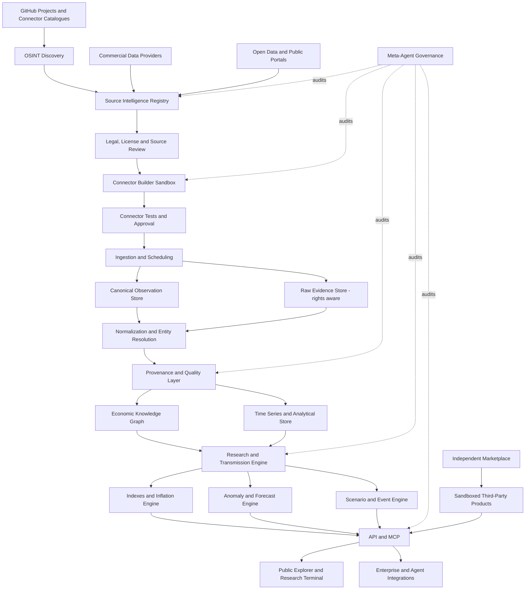

# Open Economic Intelligence Network

> **Working concept / product charter**  
> **Version:** 0.1  
> **Date:** 8 November 2026  
> **Status:** Concept and validation brief — not an implementation specification  
> **Working name:** Open Economic Intelligence Network (OEIN)

## 1. Executive summary

Open Economic Intelligence Network (OEIN) is a proposed **OSINT-first, source-agnostic economic intelligence platform**. It discovers, acquires, validates, connects and analyses publicly observable economic information from many countries and industries. It turns that information into transparent price histories, economic indicators, company and country input/output maps, research findings, forecasts and machine-readable services.

The platform is intended to combine capabilities that users currently find across several different product categories:

- **Cimri-like product and seller price comparison** at SKU, brand, category and location level.
- **Trading Economics-like macroeconomic coverage** across countries and indicators.
- **TradingView-like analysis workflows** with flexible charts, comparisons, formulas, alerts and reusable research.
- **Alternative-data research** that connects consumer prices, company activity, commodities, trade, supply chains and financial markets.
- **Palantir-like entity and relationship modelling**, but focused on the observable external economy rather than primarily operating a customer's internal data estate.
- **An independent developer/researcher marketplace** for third-party datasets, indexes, signals, models, agents and portfolios.

The primary product is not a personal inflation calculator. Personal inflation is one useful application of a broader data and research infrastructure.

The strategic thesis is:

> **Discover the observable economy, connect its signals, and make the resulting intelligence usable by people, companies and AI agents.**

The platform should start with the full range of legally usable OSINT and open-data opportunities. It must **not** be limited to free data. Paid data may be purchased when it closes an important coverage, history, quality, timeliness or licensing gap and its expected value justifies its cost.

The long-term objective is to make the platform financially self-sustaining through research subscriptions, enterprise intelligence, APIs/MCP, custom data products and a strictly separated third-party marketplace.

---

## 2. Product vision and positioning

### 2.1 What the platform is

OEIN is an **external economic intelligence network**: a continuously improving system for finding evidence about economic activity in the real world and converting it into researchable, explainable and reusable information.

It should answer questions such as:

- How has the price of the same cheese SKU changed across cities and countries?
- Which categories are driving a city's cost-of-living increase?
- Which companies, industries or countries are exposed to a change in a particular input cost?
- Are retail prices, wholesale prices and producer prices moving together or diverging?
- What observable evidence suggests that supply, demand, costs or market share may be changing?
- Which economic indicators tend to lead or lag another series, and under what conditions?
- What might a change in energy, freight, exchange rates, wages or commodity prices mean for a company, sector, country or financial asset?
- Which data is missing, stale, revised, weakly sourced or dependent on a single provider?

### 2.2 What the platform is not

At the start, OEIN should **not** attempt to be:

- A broker, exchange, execution venue or autonomous asset manager.
- A personalized investment-advice service.
- A complete real-time map of every company's confidential bill of materials, supplier contracts, production recipe, inventory and sales.
- A clone of Bloomberg, Palantir or Altana.
- A generic web scraper that copies every accessible page.
- A data reseller that assumes public visibility grants redistribution rights.
- A marketplace in which third-party claims are presented as official platform research.

### 2.3 Position relative to major platforms

| Platform/category | Established strength | OEIN's proposed distinction |
|---|---|---|
| Bloomberg and financial-data terminals | Licensed financial data, news, market workflows, reference data and professional distribution | Start from external observable economic activity and micro-level evidence; connect product, location, company, trade and macro signals into independent research products |
| Palantir Foundry | Integrates and models an organisation's data, assets, relationships and operational processes through an ontology | Focus on continuously discovering and connecting external economic evidence across organisations, countries, products and markets |
| Altana | Supply-chain graph built from public/commercial records, proprietary logistics operations data and customer data; value-chain and supplier-network mapping | Do not replicate its core supply-chain product. Focus on a broader combination of consumer/product prices, macroeconomics, company/country economics, market transmission, forecasts and public research access |
| TradingView | Charts, indicators, comparisons, scripts and a creator economy | Apply comparable research and creator workflows to economic, product, company, country and alternative-data signals |
| Trading Economics / Truflation / Numbeo | Macroeconomic series, alternative inflation, cost-of-living and price information | Connect more granular product/location observations to companies, sectors, supply chains and financial-market hypotheses |
| Facteus / Earnest Analytics and alternative-data providers | Consumer transaction and commercial activity data for institutional research | Seek a more transparent, source-auditable and potentially broader OSINT-first research layer; use commercial data where it materially improves the product |
| Cimri / Keepa / Open Prices / grocery price APIs | Product and retailer price tracking | Extend product price observations into cross-country, category, macroeconomic and market-impact research |

These are positioning hypotheses, not claims that competitors lack every capability listed in the right-hand column. Competitive analysis must be revisited as products and licensing terms change.

### 2.4 Potential differentiators

The product should aim to differentiate through the combination of:

1. **Source independence:** no single provider is a critical single point of failure.
2. **OSINT discovery:** use existing projects, data portals, public records, research repositories and web archives to discover sources and methods.
3. **Micro-to-macro linkage:** connect exact products and locations to categories, sectors, companies, countries and macroeconomic indicators.
4. **Evidence and provenance:** make it possible to trace each published result back to its sources, versions, collection times and transformation steps.
5. **Research depth:** support comparisons, event studies, lead-lag analysis, anomaly detection, forecasts and scenario analysis.
6. **AI-agent usability:** expose structured, documented, permission-aware data and research tools through APIs and MCP.
7. **Accessible research:** make useful alternative-data workflows available to individual investors, researchers and smaller firms, not only large institutions.
8. **Independent marketplace:** allow external creators to sell research and tools without making them part of the trusted Core system.

The differentiator must be proven with real coverage, data quality, research results and paying customers. It cannot be established by product positioning alone.

---

## 3. Target users and use cases

### 3.1 Individual users and investors

- Personal inflation and purchasing-power tracking.
- Compare the same product across cities, countries, stores and time periods.
- Compare official inflation with alternative indexes and understand methodological differences.
- Explore economic indicators and their relationship to sectors and financial assets.
- Access research tools that are normally expensive or fragmented across institutional platforms.

The aim is to reduce the information and tooling gap between professional and individual investors. It is not to promise equal information, guaranteed returns or professional investment advice.

### 3.2 Companies and procurement teams

- Compare supplier quotes and market reference prices.
- Track raw-material, energy, freight, packaging and labour-cost indicators.
- Identify alternative sourcing countries and supplier concentration risks.
- Monitor competitor prices and regional price changes.
- Estimate cost pass-through and likely future procurement pressure.
- Give agentic procurement systems structured and auditable market context.

### 3.3 Marketing, pricing and commercial teams

- Monitor price positioning and competitor promotions.
- Detect regional price dispersion and changes in consumer affordability.
- Analyse substitution between brands and product categories where quantity/sales data exists.
- Compare search interest, public demand signals, availability and price changes.
- Support pricing and promotion decisions with evidence rather than unsupported AI assertions.

### 3.4 Quantitative researchers, funds and trading agents

- Build alternative inflation and economic activity signals.
- Link product, trade, company and cost data to equities, bonds, rates, FX, futures, commodities and ETFs.
- Test whether a signal leads or lags official releases or market prices.
- Research earnings, margins, inventory, pricing power and market share.
- Feed independent agentic trading systems with evidence, structured data and uncertainty measures.

OEIN should initially provide information and research infrastructure, not execute trades or provide personalised portfolio recommendations.

### 3.5 AI agents and software developers

- Query product and price histories.
- Retrieve source-level evidence and methodology.
- Compare countries, cities, sectors, companies and indicators.
- Run approved analytics and forecasting tools.
- Subscribe to events or alerts.
- Use the same data through REST APIs and MCP tools.

---

## 4. Product surfaces

The platform should share one Core data and intelligence infrastructure while exposing different interfaces.

### 4.1 Public Price & Economy Explorer

A public web experience for:

- Product and category price comparisons.
- Country and city price maps.
- Official versus alternative inflation comparisons.
- Public economic indicators.
- Selected historical series and explainable research findings.

A free tier can create reach and demonstrate data quality. It should not be assumed to be the main revenue source.

### 4.2 Research Terminal

A professional, TradingView-inspired research workspace:

- Multi-series charts and overlays.
- Country, city, product, company and sector comparisons.
- Custom formulas, ratios, spreads and rebasing.
- Filters, watchlists, alerts and saved research.
- Maps and geographic drill-down.
- Event timelines and annotations.
- Source, methodology, coverage and quality panels.
- Reproducible notebooks or research workspaces.

### 4.3 Economic Intelligence API and MCP

An API-first service for humans, applications and agents. Candidate endpoints/tools:

- `prices.search`, `prices.history`, `prices.compare`
- `products.search`, `products.resolve`, `products.history`
- `locations.search`, `locations.compare`, `maps.layers`
- `indexes.list`, `indexes.get`, `indexes.explain`
- `economy.indicators`, `economy.compare`
- `companies.profile`, `companies.inputs`, `companies.outputs`, `companies.relationships`
- `countries.inputs`, `countries.outputs`, `countries.trade`
- `sources.list`, `sources.health`, `sources.provenance`
- `research.search`, `research.get`, `research.reproduce`
- `forecasts.get`, `forecasts.evaluate`
- `events.search`, `events.impact_hypotheses`

All outputs should include timestamps, units, currency, geography, source identifiers, coverage, methodology/version, quality indicators and uncertainty where applicable.

### 4.4 Enterprise Intelligence

Potential vertical offerings:

- Competitive price intelligence.
- Procurement and commodity-cost intelligence.
- Country and sector risk intelligence.
- Company and supply-chain dossiers.
- Retail and consumer market monitoring.
- Custom data pipelines and licensed data products.

### 4.5 Data & Signal Marketplace

A separate ecosystem for third-party creators to distribute:

- Datasets they own or are licensed to distribute.
- Derived indexes and indicators.
- Research reports and company/country dossiers.
- Forecast models and scenario tools.
- Trading strategies and portfolios.
- Procurement, pricing and marketing agents.
- Reusable analytics, scripts and dashboards.

The Marketplace is not part of the trusted Core research system. See Section 13.

---

## 5. Data acquisition strategy: OSINT-first, not free-only

### 5.1 Principle

Use the full range of lawful OSINT and open-data methods first because they lower initial acquisition costs, reveal the data landscape and help identify gaps. Do not reject paid data merely because it is paid.

A commercial data source should be considered when it provides material incremental value in one or more of:

- Historical depth.
- Geographic, product or company coverage.
- Observation frequency or latency.
- Accuracy and validation.
- Unique datasets unavailable from public sources.
- Contractual rights to store, process, derive, display or commercialise outputs.
- Reduced collection and maintenance cost.

### 5.2 OSINT source classes

| Source class | Examples of information |
|---|---|
| Government and statistical agencies | CPI, PPI, wages, production, trade, energy, housing, transport, taxes, public procurement |
| Central banks and regulators | Rates, monetary data, credit, financial stability, market statistics, regulated-company disclosures |
| Company disclosures | Annual and quarterly reports, earnings releases, investor presentations, product catalogues, capacity and investment disclosures |
| Public company registries | Legal entities, subsidiaries, ownership, directors and corporate events where lawfully accessible |
| E-commerce and retail | Product identity, price, unit, seller, availability, promotions and public catalogue changes |
| Manufacturer and distributor catalogues | Product specifications, pack sizes, suggested prices and product launches |
| Trade and customs datasets | Import/export values and quantities, partner countries, product classifications |
| Commodity and energy sources | Agriculture, metals, oil, gas, electricity, inventories and production |
| Transport and logistics | Port calls, freight, routes, public shipment information, infrastructure and capacity |
| Geospatial sources | Facilities, factories, ports, warehouses, farms, mines, power plants and land use |
| Labour and recruitment | Public job listings, wages, hiring trends and skill demand; respect platform terms and personal-data rules |
| News and public announcements | Policy changes, strikes, disruptions, product launches, factory closures and corporate events |
| Academic research | Papers, supplementary datasets, code, replication packages and methodologies |
| Web archives | Historical snapshots of publicly accessible pages and catalogues |
| Community contributions | Receipts, shelf labels, product observations and local price reports with evidence and fraud controls |
| Paid/open commercial providers | Licensed retail, transactions, shipment, location, financial and historical datasets |

### 5.3 Mine open-source projects for their data sources

GitHub projects are not only code examples. Their connectors, provider lists, schemas, tests, configuration files, documentation, issue trackers, pull requests and commit history can reveal valuable data sources and collection methods.

For each relevant repository, the discovery process should inspect:

1. Connector/provider directories and package manifests.
2. API endpoint definitions and authentication requirements.
3. YAML/JSON source configuration and classification files.
4. Test fixtures, example responses and test data.
5. Documentation, citations and source acknowledgements.
6. Issues and pull requests concerning broken or newly added sources.
7. Commit history and deprecated/removed connectors.
8. Code license, data license, attribution and commercial-use conditions.
9. Whether the repository's source is itself original, mirrored or derived from another provider.

A project that contains 20 connectors may reveal only 12 independent upstream sources. Build a source dependency graph so mirrored data is not misrepresented as independent corroboration.

### 5.4 Source discovery workflow

1. Discover candidate sources from projects, catalogues, public portals, search, academic papers and references.
2. Resolve the original publisher/provider rather than relying only on a secondary aggregator.
3. Identify exact data fields, geography, granularity, frequency and history.
4. Test a small sample through a permitted access method.
5. Determine source, data and software licenses separately.
6. Evaluate data quality, uniqueness, coverage and cost.
7. Build or reuse a connector in an isolated test environment.
8. Run schema, consistency, rate-limit and provenance tests.
9. Register the source and its dependencies.
10. Activate in Core only after required legal and quality checks.

---

## 6. Candidate open-source projects and source ecosystems

These are **research references**, not a decision to adopt every project or reuse its code/data. Current capabilities, maintenance, API access and licensing must be rechecked before implementation.

| Project | What to study or potentially reuse | Important caveat |
|---|---|---|
| [OpenBB](https://github.com/openbq-org/OpenBB) | Financial/economic data provider architecture, typed client, REST API, MCP and provider extensions | Provider data terms remain separate; inspect each provider's commercial rights |
| [Open Prices](https://github.com/openfoodfacts/open-prices) | Price observations, proof images, locations, product matching, REST API and community contributions | Data is under ODbL; attribution/share-alike and restrictions on combining non-open data matter |
| [FollowTheMoney](https://github.com/opensanctions/followthemoney) | Entity graph data model, normalization, validation, identifiers and source references | Software license is MIT; this does not make OpenSanctions datasets commercially free |
| [OpenSanctions](https://github.com/opensanctions/opensanctions) | Source crawling, entity resolution, data provenance, dataset versioning and monitoring | Code and data have different licenses; dataset is CC BY-NC 4.0 and commercial use requires a separate license |
| [Open Supply Hub](https://opensupplyhub.org/) | Production facility registry, facility identity resolution and contributor workflow | API is governed by its own terms; inspect restrictions, including competitive-use and redistribution clauses |
| [Trase](https://trase.earth/) | Commodity supply-chain and trade-flow research, geographic linkage and methodology | Coverage and dataset licenses vary; do not assume universal commodity coverage |
| [OEC](https://oec.world/) | Country/product trade relationships, economic complexity and visual exploration | Check data provenance, API and reuse terms for each data component |
| [Meltano](https://github.com/meltano/meltano) and [Meltano Hub](https://hub.meltano.com/singer/docs/) | Singer taps/targets, connector metadata, extraction patterns and connector-maintenance signals | Connector quality and source permissions vary; a working tap does not grant data rights |
| [Dagster](https://github.com/dagster-io/dagster) | Data orchestration, asset lineage, schedules, observability and testing | Evaluate operational complexity and license for the selected edition/features |
| [Common Crawl](https://commoncrawl.org/get-started) | Historical web snapshots and large-scale public web research | Archive availability does not grant permission to republish every archived page or underlying content |
| [OpenAlex](https://openalex.org/) | Academic papers, authors, institutions, datasets and research discovery | OpenAlex metadata is CC0; individual linked publications and full texts have their own rights |
| [Global Energy Monitor](https://globalenergymonitor.org/) | Facility-level power, mining, steel and other infrastructure datasets | Dataset coverage and licenses must be checked per release |
| [FAOSTAT](https://www.fao.org/faostat/) | Agricultural production, food balance, producer prices, trade and related series | Check source-specific terms and country-level methodology |
| [World Bank Data Catalog](https://datacatalog.worldbank.org/) | Development indicators, country series, sector and project data | Many World Bank-produced datasets are CC BY 4.0, but the catalog also contains datasets with different restrictions |
| [Fincept Terminal](https://github.com/Fincept-Corporation/FinceptTerminal) | Financial terminal UX and research workflow ideas | Current repository documentation identifies AGPL-3.0-or-later and a separate Enterprise product; do not copy, fork or deploy commercially without legal review and the required rights |

### 6.1 Important licensing lessons

- Software license and data license are different things.
- A project being on GitHub does not mean its underlying data is open for commercial use.
- Publicly accessible data is not automatically redistributable.
- A derived index or signal is not automatically free of source-license obligations.
- ODbL, CC BY-NC, AGPL and contractual API terms can have material effects on architecture and monetization.
- Some datasets contain third-party material whose rights are not controlled by the repository maintainer.
- Keep a rights record at the source, dataset, field and output level where practical.

Examples to study carefully:

- [Open Prices data and ODbL guidance](https://openfoodfacts.github.io/open-prices/guides/data/)
- [OpenSanctions copyright and data licensing](https://github.com/opensanctions/opensanctions/blob/main/COPYRIGHT.md)
- [OpenSanctions commercial-use guidance](https://www.opensanctions.org/docs/commercial/exemption/)
- [Open Supply Hub API Terms](https://info.opensupplyhub.org/resources/api-terms-of-service)
- [UN Comtrade data-use policy](https://uncomtrade.org/docs/policy-on-comtrade-data-use/)
- [World Bank data licenses](https://datacatalog.worldbank.org/public-licenses)
- [Fincept current commercial license notice](https://github.com/Fincept-Corporation/FinceptTerminal/blob/main/docs/COMMERCIAL_LICENSE.md)

---

## 7. Historical data strategy

The platform should not assume that its historical series begin only when its own collector starts. It should actively search for lawful historical observations and archives.

### 7.1 Historical data methods

- Public historical datasets and government archives.
- Historical APIs and data dumps.
- Licensed historical data from commercial providers.
- Existing price-comparison and product-history services, subject to their terms.
- Web archives such as Common Crawl and other lawful archives.
- Historical catalogues, circulars, brochures and price lists.
- Company reports and investor presentations.
- Academic replication datasets and supplementary files.
- User-provided receipts and historical records with provenance.
- Reconstruction from indirect variables, clearly labelled as estimated rather than observed.

### 7.2 Never blur observed and estimated history

Every observation should have a provenance class:

- `OBSERVED`: recorded at or near the actual observation time.
- `ARCHIVED`: retrieved later from a dated historical source.
- `REPORTED`: published by a company, institution or source for a stated period.
- `ESTIMATED`: model-derived or reconstructed from indirect information.

These classes must not be silently mixed in a chart, index or backtest.

### 7.3 Time and revision model

Store separate time fields where available:

- `observation_time`: when the economic event/price was observed.
- `published_at`: when the source published the record.
- `retrieved_at`: when OEIN collected it.
- `valid_from` / `valid_to`: period the value applies to.
- `vintage_id` or source version: which release/snapshot was used.

For revised series, support:

- `AS_PUBLISHED`: what was known at the time.
- `LATEST_REVISED`: the latest corrected value currently available.

This is essential for honest historical analysis and point-in-time backtesting.

---

## 8. Data retention and storage policy

Do **not** store every byte from every source by default. Do **not** rely exclusively on on-demand fetching either.

Use a hybrid, rights-aware model.

| Layer | Retention approach | Reason |
|---|---|---|
| Source registry | Persistent | Source identity, terms, health, scope, dependencies and access history |
| Entity/product/location registry | Persistent and versioned | Stable identifiers, deduplication and relationships |
| Canonical observations | Persistent where rights allow | Historical comparisons, reproducibility and independent analysis |
| Raw documents/responses | Retain where licensed/permitted; otherwise retain allowed metadata, hashes and references | Evidence, parsing, audit and reprocessing without unlawful archival |
| Cache | Temporary and source-policy-aware | Lower latency and repeated fetch cost |
| Research snapshots | Persistent and immutable/versioned | Reproduce published indexes, signals, forecasts and reports |
| Model outputs | Persistent with model/data version | Evaluate forecast performance and research history |

### 8.1 On-demand fetching: when it is appropriate

Use on-demand retrieval when:

- The source is reliable and accessible when requested.
- The license or terms do not permit long-term storage.
- Historical reproduction is not required.
- The data is low-value or rarely queried.
- The API cost and latency are acceptable.

### 8.2 Persistent storage: when it is important

Store permitted data when:

- The source may disappear, change or revise history.
- The observation is uniquely valuable.
- Historical price or event analysis is a core product feature.
- Backtesting requires point-in-time data.
- Customers have paid for a report or index that must be reproducible.
- The cost of repeated API calls is greater than retention cost.

### 8.3 Evidence retention

Where lawful, store original files or responses in object storage with checksums, retrieval metadata and version identifiers. Where full retention is not allowed, preserve only what is permitted: a citation, source identifier, retrieval timestamp, hash, extracted licensed fields or derived output as applicable.

---

## 9. Unified data model and economic knowledge graph

A database is required even if some source data is fetched on demand. It should store the identity, metadata, provenance and relationships needed to connect data across time.

### 9.1 Core entities

- `Source`, `Dataset`, `Connector`, `License`, `SourceDependency`
- `Country`, `Region`, `City`, `District`, `PostalArea`, `Facility`, `Store`, `Port`, `Route`
- `Company`, `LegalEntity`, `Subsidiary`, `Owner`, `Supplier`, `Customer`
- `Product`, `SKU`, `Barcode`, `Brand`, `ProductVariant`, `Category`, `Commodity`, `Material`
- `Industry`, `Sector`, `EconomicActivity`, `TradeFlow`
- `Observation`, `Price`, `Quantity`, `Inventory`, `Capacity`, `FinancialMetric`, `EconomicIndicator`
- `Index`, `ResearchFinding`, `Hypothesis`, `Forecast`, `Scenario`, `Event`, `ModelRun`

### 9.2 Price observation minimum fields

A canonical price observation should include, when known:

- Product/SKU identifier and match confidence.
- Exact/comparable/category classification.
- Source and source record identifier.
- Seller/store and location.
- Price, currency, tax treatment and unit.
- Pack size/quantity and normalized unit price.
- Promotion/discount status and conditions.
- Availability/stock status where observable.
- Observation, publication and retrieval timestamps.
- Evidence/proof URL or document reference.
- Provenance class (`OBSERVED`, `ARCHIVED`, `REPORTED`, `ESTIMATED`).
- License and permitted-use policy.
- Quality flags and validation history.

### 9.3 Product matching levels

Never treat unlike products as identical without qualification:

1. `EXACT_SKU`: same barcode/variant and pack size.
2. `EXACT_PRODUCT`: same manufacturer product and specification, where SKU differs only by market identifier.
3. `COMPARABLE_PRODUCT`: similar composition, quality, size and use, but not identical.
4. `CATEGORY`: aggregate product class.

Price comparisons must disclose which level is being used.

### 9.4 Economic relationship graph

Represent relationships as dated, sourced edges rather than timeless assertions.

Examples:

- Company A `SUPPLIES` component B to Company C.
- Country A `EXPORTS` commodity B to Country C.
- Product A `CONTAINS` material B.
- Facility A `PRODUCES` product B.
- Commodity A `INPUT_TO` industry B.
- Company A `OPERATES` facility B.
- Product A `SOLD_AT` store B.
- Indicator A `MAY_LEAD` indicator B under tested conditions.

Every relationship needs evidence, observation period, confidence, source and status. Distinguish reported relationships from inferred relationships.

---

## 10. Company and country input/output intelligence

One major research module should attempt to map the observable inputs and outputs of a company, industry or country.

### 10.1 Company intelligence dossier

For a public company, discover and connect as much of the following as sources allow:

**Inputs / upstream**

- Raw materials and commodities.
- Components and packaging.
- Suppliers and supplier countries.
- Energy, water and logistics exposure.
- Labour and skills requirements.
- Capital expenditure and financing.

**Operations**

- Facilities, locations and capacity.
- Product lines and manufacturing activity.
- Inventory and production disclosures.
- Technology, process and material dependencies.

**Outputs / downstream**

- Products, services and brands.
- Customers and distribution channels where disclosed.
- Domestic sales and exports.
- Product/retail prices where observed.
- Competitors and substitutes.
- Revenue, margins and other reported financial outcomes.

The graph must label evidence quality. Supplier relationships may be reported, observed in trade data, inferred from multiple clues, estimated or unknown. Do not claim that every input, customer, bill of materials, inventory or production recipe can be discovered from public information.

### 10.2 Country intelligence dossier

For a country, connect:

- Imports/exports by product, industry and partner.
- Domestic production and consumption.
- Intermediate input dependencies.
- Energy and food dependence.
- Labour, wages and employment.
- Production capacity and infrastructure.
- Public procurement and major investments.
- Sector value added and input-output tables.
- Commodity and currency exposure.

Use official input-output tables and supply-use tables where available, supplemented by more granular evidence. Never treat incomplete public trade data as a complete map of an economy.

---

## 11. Price indexes, inflation and comparison methodology

### 11.1 Three distinct index families

1. **Independent price indexes:** indexes calculated from the platform's observed sources and disclosed weighting methodology.
2. **Official-methodology comparisons:** comparisons or replications that attempt to follow a published official methodology, subject to data availability.
3. **Personal inflation:** indexes based on an individual's household spending weights or actual expenditure data, subject to privacy and consent safeguards.

### 11.2 Official versus alternative inflation

The platform should not claim that a different result proves an official statistic is false. Differences can arise from:

- Product and outlet coverage.
- Geography and sample design.
- Weights and household expenditure patterns.
- Product replacement and quality adjustment.
- Promotions and availability.
- Timing and collection frequency.
- Index formula and chaining method.
- Missing data and source selection.

Every index must publish its methodology, coverage, weights, limitations, update schedule and revision policy.

### 11.3 Cross-country and cross-city product comparison

Possible dimensions:

- Exact barcode/brand/pack-size comparison.
- Local currency and common-currency comparisons.
- Unit price (per kg, litre, item, kWh, m², etc.).
- Tax/VAT treatment.
- Promotion versus regular price.
- Availability and delivery cost where known.
- PPP-adjusted affordability, clearly separated from FX conversion.
- Median, quantiles, dispersion and store coverage.

Example: Compare the price increase of the same fresh-cheese SKU between Istanbul, Ankara, Izmir, Berlin and Warsaw; then separately compare comparable fresh-cheese products and category indexes.

---

## 12. Quantitative research, forecasts and market transmission

### 12.1 Economic Transmission Graph

Connect observable economic data to possible downstream effects.

Illustrative chain:

`feed / grain / fertilizer / energy costs → farm-gate milk prices → dairy processing costs → wholesale dairy prices → retail prices → food inflation → inflation expectations → rates / bonds / FX / equities`

Other chains can include:

- Oil → transport and petrochemicals → packaging → consumer goods.
- Copper and electricity → grid investment and electrical equipment → industrial costs.
- Freight and port congestion → import costs → inventory → retail prices.
- Wages and rent → service-sector costs → service inflation.
- Weather and crop yields → food supply → commodity futures → food manufacturers.

The graph should also connect outputs to relevant:

- Equities and sectors.
- Government bonds and yields.
- Interest-rate futures.
- FX pairs.
- Commodity futures and spot prices.
- ETFs and factor exposures.
- Credit and default-risk indicators.

### 12.2 Correlation is not causation

Every discovered link must be labelled as one of:

- Observed descriptive relationship.
- Statistical association.
- Lead/lag relationship.
- Predictive relationship validated out of sample.
- Causal hypothesis.
- Causal estimate supported by a specified identification method.

Do not promote a correlation to a causal claim. A real economic effect may already be priced into a financial asset.

### 12.3 Research examples

- Regional price dispersion: which city sees a category price acceleration first?
- Shrinkflation: detect pack-size reduction and unit-price changes.
- Cost pass-through: estimate how input-cost changes flow into wholesale and retail prices.
- Market share proxies: compare public product availability, pricing and sales disclosures, while clearly labelling proxies.
- Affordability: compare wages, rents, food and energy costs across cities and household profiles.
- Import dependence: estimate exposure of industries and companies to specific countries or commodities.
- Inflation nowcasting: estimate the current period before official releases, then compare after publication.
- Company margin pressure: connect input prices, reported selling prices and financial statements.
- Policy-event analysis: study how tariffs, taxes, subsidies, strikes or sanctions affect relevant products and firms.

### 12.4 Hierarchical and multi-dimensional forecasting

Forecast across multiple linked hierarchies:

**Product hierarchy**  
SKU → exact product → brand/variant → comparable product group → subcategory → category → industry/sector.

**Geographic hierarchy**  
Store → neighbourhood/postal area → district → city → region/province → country → economic region → global.

**Supply-chain hierarchy**  
Raw material → producer price → processor/manufacturer → wholesale → retail → consumer expenditure.

**Company/country hierarchy**  
Facility → company → industry → country → region/global; and supplier/customer tiers where evidence supports them.

**Time hierarchy**  
Intraday (where appropriate) → daily → weekly → monthly → quarterly → annual.

**Value/normalisation dimensions**  
Local currency → common currency → real price → PPP-adjusted measure, each shown separately.

Forecasts at different levels should be reconciled where mathematical aggregation is valid. Do not add raw prices across unlike products or locations. Use suitable methods such as bottom-up, top-down, middle-out and forecast reconciliation (including MinT where assumptions are appropriate). Support probabilistic forecasts and prediction intervals.

Candidate model families include:

- ETS and ARIMA/SARIMA.
- VAR/VECM for multivariate dynamics.
- Gradient boosting and other machine-learning models.
- State-space and dynamic factor models.
- Hierarchical Bayesian models.
- Change-point and anomaly detection.
- Event studies and causal inference methods where suitable.

Model choice should be driven by data availability and out-of-sample performance, not fashion.

### 12.5 Forecast evaluation rules

- Store forecast vintages before outcomes are known.
- Use point-in-time data to prevent look-ahead bias.
- Compare against simple baselines and official benchmarks.
- Report errors by horizon, country, category and regime.
- Track calibration and interval coverage, not only point error.
- Record model version, feature version and source vintage.
- Publish failures and model degradation.
- Distinguish nowcasts, forecasts, scenarios and stress tests.

---

## 13. Third-party Data & Signal Marketplace — strict separation from Core

The marketplace is a distinct commercial product and trust domain. Third-party content must never be confused with the platform's own official datasets, indexes or research.

### 13.1 Core versus Marketplace

| Area | Core platform | Marketplace |
|---|---|---|
| Ownership | OEIN | Independent creator/provider |
| Data pipelines | Platform-governed | Creator-controlled or separately approved |
| Source approval | Core source governance | Marketplace admission/moderation, then separate Core review if proposed for ingestion |
| Research claims | Platform methodology and validation | Creator's responsibility, shown with independent validation status |
| Storage and namespace | Separate Core data stores and APIs | Separate tenant/product stores and APIs |
| Publishing | Core release process | Marketplace submission and review |
| Reputation | Platform quality metrics | Creator/product-specific track record |

### 13.2 Technical isolation requirements

- Separate tenant namespaces and storage boundaries.
- Separate API namespace (for example `/core/` and `/marketplace/`).
- Marketplace code runs in sandboxed environments.
- Third-party tools cannot write into Core databases.
- No automatic ingestion of marketplace datasets into official indexes.
- Any proposed Core ingestion goes through the full source, legal, quality and security pipeline.
- Product cards clearly label author, ownership, source, license, version and validation status.

### 13.3 Marketplace product types

- Research reports and company/country dossiers.
- Alternative inflation and sector indexes.
- Datasets with valid distribution rights.
- Indicators and chart studies.
- Forecast models and scenario simulators.
- Backtested and paper-traded strategies.
- Independently verified live portfolios where evidence is available.
- Procurement, pricing and marketing agents.
- MCP tools and reusable research workflows.

### 13.4 Trading strategy and portfolio transparency

A strategy or portfolio should distinguish:

- Backtest / historical simulation.
- Paper trading.
- Live brokerage account performance.
- Gross versus net returns.
- Fees, slippage and market impact assumptions.
- Benchmark and risk exposure.
- Maximum drawdown and volatility.
- Data version and point-in-time integrity.
- Survivorship and look-ahead bias checks.
- Audited/verified versus self-reported results.

Popularity must not be presented as evidence of performance or quality.

### 13.5 Marketplace monetization

Possible models:

- Subscription bundles.
- One-time reports or dataset access.
- Usage-based APIs.
- Revenue share on creator subscriptions.
- Enterprise licensing.

The platform should earn a transparent commission or distribution fee while clearly separating marketplace liability and claims from Core research. Legal terms and consumer/investment regulations require dedicated review.

---

## 14. Autonomous agents and Meta-Agent governance

Autonomy should reduce repetitive research and connector maintenance, not remove evidence, licensing and safety controls.

### 14.1 Source discovery agents

Discover sources from:

- GitHub repositories and connector registries.
- Public data portals and API catalogues.
- Company and government disclosures.
- Research papers and replication packages.
- Official country-specific sources.
- Web archives and public catalogues.
- Commercial data provider catalogues.

### 14.2 Source intelligence agent

For each candidate source, determine:

- Publisher and original data owner.
- Country, sector, product and entity coverage.
- Data granularity and history.
- Update frequency and latency.
- Access mechanism and authentication.
- Data quality and revision behaviour.
- Code license versus data license.
- Rights to access, collect, store, process, derive, display, redistribute, monetize and train AI.
- API cost, rate limits and operational restrictions.
- Alternative sources and source dependencies.

Unknown legal rights must remain `UNKNOWN`; the agent must not infer permission from public accessibility.

### 14.3 Autonomous connector builder

- Select an existing connector or propose a new one.
- Build in an isolated development/sandbox environment.
- Generate schema, tests and documentation.
- Test sample extraction, pagination, rate limits, retries and failures.
- Validate units, timestamps, identifiers and data shape.
- Detect page/API structure changes.
- Submit connector for security, legal and data-quality review.
- Never receive unrestricted production credentials or deploy directly to production without approval gates.

### 14.4 Source lifecycle states

| State | Meaning | System behaviour |
|---|---|---|
| `ACTIVE` | Source is responding and passing checks | Normal ingestion |
| `DEGRADED` | Late, incomplete, inconsistent or lower-quality data | Reduce confidence; alert; fallback where possible |
| `PASSIVE` | Source has stopped providing new data or has become unavailable | Preserve permitted history; stop treating as live |
| `QUARANTINED` | Suspected false, manipulated, corrupted or unsafe data | Stop use pending investigation |
| `RETIRED` | Source closed, permission ended or connector permanently removed | Archive permitted records and seek replacement |

The source registry should record state history and reasons for transitions.

### 14.5 Source health and dependency graph

A source health assessment may consider:

- Uptime and freshness.
- Completeness and schema stability.
- Error and revision rates.
- Historical consistency.
- Independent corroboration.
- Geographic and product coverage.
- Provenance clarity.
- Manipulation or anomaly indicators.
- License status and terms changes.
- Upstream source dependencies.

A numeric score should not conceal missing evidence. Display the score's components and uncertainty.

### 14.6 Meta-Agent

Meta-Agent is a cross-cutting governance and quality layer, not a single LLM that is trusted to certify everything.

Recommended specialist roles:

- **Source Auditor:** provenance, source independence, freshness and manipulation risk.
- **Legal/License Auditor:** source, dataset, code, retention and output rights; flags unknowns for human review.
- **ETL Auditor:** connector correctness, schema drift, extraction quality and code safety.
- **Entity Resolution Auditor:** duplicate entities, product matches and relationship confidence.
- **Research Auditor:** methods, sample quality, alternative explanations and statistical validity.
- **Forecast Auditor:** point-in-time integrity, out-of-sample results, calibration and model drift.
- **Security Auditor:** prompt injection, malicious documents, secrets and sandbox boundaries.
- **Cost/Value Auditor:** source and agent cost versus usage, research value and revenue.
- **Marketplace Auditor:** third-party disclosures, prohibited claims and separation from Core.

Possible outcomes:

- `APPROVE`
- `INVESTIGATE`
- `QUARANTINE`
- `REJECT`

Critical controls should be deterministic where possible, independently tested and human-approved where legal, financial or security impact is material. Meta-Agent itself must be monitored and evaluated.

### 14.7 Intelligence Portfolio Manager

A coordinating role can prioritise the platform's work:

- Which data gaps are most valuable to close?
- Which sources are redundant or too costly?
- Which verticals have enough coverage to create a saleable product?
- Which research hypotheses deserve testing?
- Which models or agents are underperforming?
- Which paid datasets are justified by demand and incremental value?

This agent should recommend work, not override budget, legal or security controls.

---

## 15. Legal, licensing, privacy and security principles

This is product architecture guidance, not legal advice. Jurisdiction-specific legal review is required before commercial collection, storage, redistribution or investment-related functionality.

### 15.1 Separate rights by activity

Track rights independently for:

- `ACCESS`
- `COLLECT`
- `STORE`
- `PROCESS`
- `DERIVE`
- `DISPLAY`
- `REDISTRIBUTE`
- `MONETIZE_DERIVED`
- `TRAIN_AI`

A source may allow one activity and prohibit another.

### 15.2 Legal and operational checks

- Website terms, API terms and technical access restrictions.
- Copyright, database rights and contractual restrictions.
- Scraping, rate limits, robots policies and anti-bot restrictions.
- Commercial reuse and redistribution rights.
- Rights to retain historical snapshots.
- Rights to publish derived indexes and analysis.
- Personal data, privacy, consent and lawful basis.
- Cross-border transfer requirements.
- Market data licensing for exchanges and financial vendors.
- Consumer protection and advertising rules.
- Investment-advice, portfolio management and financial-promotion regulation.

Do not bypass logins, CAPTCHA, paywalls, access controls or technical restrictions. Do not assume public visibility grants permission to automate access or resell data.

### 15.3 Legal policy engine

Each source/dataset should have machine-readable policy metadata, for example:

- `PUBLIC_USE`
- `INTERNAL_ONLY`
- `LICENSED_DERIVATIVES_ONLY`
- `LICENSED_REDISTRIBUTION`
- `PROHIBITED`
- `UNKNOWN`

These values are operational labels, not a substitute for the actual contract/license. Keep evidence, reviewer, date, jurisdiction and policy version.

### 15.4 Investment disclaimer and product boundary

A general informational disclaimer may say:

> OEIN provides economic data, analytical research and model-generated estimates for informational and research purposes. It does not provide personalised investment advice, portfolio management or a guarantee of investment performance.

A disclaimer alone does not determine the legal classification of a product. Personalised recommendations, automated portfolio decisions, trade execution, paid signals and marketing claims require separate legal and regulatory analysis in each target market.

### 15.5 Security

OSINT content is untrusted input. Protect against:

- Prompt injection embedded in websites and documents.
- Malicious PDFs, spreadsheets and archives.
- Fake or lookalike data sources.
- Poisoned price observations and manipulated datasets.
- Connector code supply-chain attacks.
- Credential exfiltration and SSRF.
- Excessive permissions and cross-tenant data exposure.

Controls:

- Sandboxed extraction and parsing.
- No production secrets in source-discovery or connector-generation agents.
- Least-privilege credentials and egress controls.
- Allowlisted domains and controlled network access.
- Code review, dependency scanning and reproducible builds.
- Signed/versioned connectors and rollback.
- Immutable audit logs for important data changes.
- Strict tenant isolation between Core and Marketplace.

---

## 16. Data reliability and research transparency

Every published metric, result or forecast should carry a reliability panel.

Candidate attributes:

- Number of sources and independent upstream sources.
- Number of observations and coverage period.
- Geographic/product/entity coverage.
- Freshness and expected update interval.
- Missingness and sampling limitations.
- Exact versus comparable product share.
- Source dependency concentration.
- Legal/redistribution status.
- Methodology and version.
- Confidence interval or uncertainty measure.
- Last validation and known caveats.

A finding should clearly show whether it is:

- Directly observed.
- Reported by a source.
- Derived by a deterministic calculation.
- A statistical association.
- A hypothesis.
- A forecast or scenario.
- A causal estimate.

The platform must be willing to say `INSUFFICIENT_DATA`, `LOW_CONFIDENCE` or `UNKNOWN`.

---

## 17. Maps and geographic intelligence

Maps are useful when data has meaningful geographic attributes. They should not be added merely as decoration.

Potential map layers:

1. Product and category prices by store, district, city and country.
2. Regional inflation and affordability.
3. Factories, farms, mines, warehouses, ports and power plants.
4. Commodity production regions and export corridors.
5. Trade routes and partner-country flows where data permits.
6. Company facility and supplier/customer relationships.
7. Regional anomalies, price dispersion and economic exposure.

Use open geospatial datasets and mapping tools where permitted. Every layer should include source date, spatial precision, coverage and licensing. Do not infer precise facility or personal locations from weak evidence.

---

## 18. Technical architecture — logical view

The following is a logical architecture, not a locked technology selection.

### 18.1 Design principles

- API-first; web, terminal and agents use the same underlying services.
- Source and connector adapters are modular and replaceable.
- Preserve raw evidence where rights allow; preserve lineage in all cases.
- Keep canonical observations separate from derived indexes and research.
- Use versioned schemas and entity identifiers.
- Use event-driven ingestion where it reduces latency or cost.
- Make pipeline runs idempotent and observable.
- Support replay and backfill when legally permitted.
- Keep Core and Marketplace isolated.
- Do not overbuild distributed infrastructure before scale requires it.

### 18.2 Storage candidates

Possible starting technologies, subject to workload validation:

- PostgreSQL for source registry, metadata, entities and operational state.
- Object storage for permitted raw files, snapshots and analytical files.
- Parquet for portable analytical datasets.
- A columnar/time-series analytical store when query volume justifies it (for example ClickHouse).
- A graph database only if graph query patterns justify the operational cost; the first version may use relational edge tables.
- Search/index infrastructure for documents, entities and research retrieval.

Do not select technologies based on fashion. Benchmark with actual queries and data volumes.

---

## 19. Business model and financial sustainability

The initial commercial objective is not maximum user growth. It is to prove that at least one valuable data/research product can generate repeatable revenue and cover its operating costs.

### 19.1 Revenue streams

| Stream | Product | Likely customer |
|---|---|---|
| Research subscription | Research Terminal, saved analysis, alerts | Individual investors, analysts, researchers |
| Enterprise subscription | Competitive price, procurement and market intelligence | Manufacturers, retailers, distributors, procurement teams |
| Data API | Structured prices, indexes, company/country relationships | Developers, fintech, analytics providers |
| MCP access | Tools for AI agents | Agent developers, companies and funds |
| Custom research | Company, sector, country and supply-chain dossiers | Companies, investors and consultants |
| Custom data pipeline | Source connector, normalization and licensed data product | Enterprise clients |
| Marketplace commission | Third-party research, models, indexes and agents | Creators and paying subscribers |

### 19.2 Recommended route to first revenue

A plausible sequence:

1. Choose a narrow, valuable vertical where public sources provide enough evidence.
2. Produce a repeatable monthly or weekly research report for a defined business customer.
3. Validate that customers will pay and identify the parts of the workflow they repeatedly need.
4. Turn repeatable work into a subscription dashboard and API.
5. Add broader data coverage and licensed sources when demand justifies them.
6. Open the third-party marketplace after Core data governance, identity, billing and product isolation are mature.

The first paid product may be a **Competitive Economic Intelligence Report** rather than a broad public API. This can create early revenue while revealing which data and analytics deserve automation.

### 19.3 Cost model

Track:

- Hosting, storage, database and network costs.
- Model/token/inference costs.
- API and data licensing costs.
- Connector maintenance and operational failures.
- Legal and license review costs.
- Monitoring, security, support and payment costs.
- Human review and research labour.

A source or agent should not be judged only by technical success. Measure its incremental value relative to cost.

### 19.4 Financial sustainability metric

A basic target:

`Recurring gross contribution >= recurring operating cost`

For a realistic break-even assessment, operating cost must include ongoing maintenance, legal/compliance, customer support and necessary human review—not only cloud bills.

Potential internal metrics:

- Revenue attributable to a source or research product.
- Direct cost per customer/query/report.
- Gross margin by product.
- Cost per validated observation.
- Cost per successful forecast or research finding.
- Source failure/replacement cost.
- Customer retention and repeated usage.

---

## 20. Competitive landscape and validation questions

### 20.1 Products to monitor

- [Altana](https://altana.ai/platform) — supply-chain graph and value-chain intelligence.
- [Bloomberg](https://www.bloomberg.com/professional/solution/bloomberg-data/) — professional financial data and distribution.
- [Palantir Foundry Ontology](https://www.palantir.com/explore/platforms/foundry/ontology/) — enterprise ontology and operational data integration.
- [TradingView](https://www.tradingview.com/) — charting, indicators and creator monetization.
- [OpenBB](https://openbb.co/) — financial/economic research platform and integrations.
- [Fincept Terminal](https://github.com/Fincept-Corporation/FinceptTerminal) — open-source financial terminal; licensing is a major caveat.
- [Truflation](https://truflation.com/) — alternative inflation data.
- [Numbeo](https://www.numbeo.com/) — cost-of-living and crowd-sourced price data.
- [NedosTavka](https://nedostavka.net/en) — barcoded grocery prices and paid API.
- [Cimri](https://www.cimri.com/) — product and retailer price comparison in Türkiye.
- [Keepa](https://keepa.com/) — Amazon product price history and API.
- [Facteus](https://facteus.com/) and [Earnest Analytics](https://www.earnestanalytics.com/) — alternative consumer transaction and retail data.
- [Placer.ai](https://www.placer.ai/) — location and foot-traffic intelligence.
- [Open Prices](https://prices.openfoodfacts.org/) — collaborative product price data.
- [Trase](https://trase.earth/) — commodity supply-chain transparency.
- [Open Supply Hub](https://opensupplyhub.org/) — production facility intelligence.

### 20.2 Questions that must be answered before major investment

1. Which specific user problem is not adequately served by existing platforms?
2. Which existing products already provide the proposed data granularity, history and analysis?
3. Where can OSINT give durable and legally usable coverage advantages?
4. Which vertical has the best combination of public data, history, customer value and manageable legal risk?
5. Can we produce at least one insight or dataset that is materially better, cheaper or more accessible than alternatives?
6. Are there paying customers willing to fund the first data product?
7. Which paid datasets materially improve outcomes, and what rights are included?
8. Can our source discovery and connector automation reduce maintenance cost in practice?
9. Can our indexes and forecasts pass honest out-of-sample tests?
10. Does the independent marketplace add value after Core has a trusted customer base?

### 20.3 The Altana question

Altana is a serious competitor in supply-chain and value-chain intelligence. Its public description says its graph combines proprietary logistics operations, public and commercial records, and secure customer data; it also states that more than half of its graph comes from exclusive first-party operations data. Its AI can use customer bills of materials and supplier data to suggest upstream value-chain entities.

This demonstrates that a global supply-chain graph is not a novel concept. However, public product information does not establish that Altana has complete visibility into every company's confidential bill of materials, recipes, inventory, all retail SKU prices, actual sales, consumer expenditure and all macro-to-financial-market transmission paths.

The strategic implication is **not** to build a smaller Altana. OEIN should test whether a different, more open and research-oriented combination of granular prices, country/company economic data, macro indicators, market transmission and user-created intelligence products has a defensible market.

---

## 21. Phased validation and implementation plan

### Phase 0 — Research and feasibility (no large build)

Deliverables:

- Competitor capability matrix.
- GitHub project and connector inventory.
- OSINT Source Atlas with original providers and source dependencies.
- Country-specific source packs.
- Historical data availability map.
- License and commercial-use matrix.
- Candidate vertical comparison.
- Customer problem and willingness-to-pay interviews.

Exit gate: identify at least one vertical with meaningful, legally usable source coverage, historical depth and a credible paying customer.

### Phase 1 — Data proof of concept

Build a narrow proof, not a full platform:

- One product/category or one company/sector vertical.
- A limited number of countries/cities.
- Several genuinely independent sources.
- Historical backfill where possible.
- Source registry and provenance.
- Canonical data schema.
- Quality and source-health monitoring.
- One reproducible index or research result.
- One API endpoint.

Exit gate: repeatable ingestion, explainable output, rights reviewed and measurable usefulness.

### Phase 2 — First commercial research product

- Prepare a repeatable report or dashboard for a specific enterprise/research user.
- Measure time saved, decision value and willingness to pay.
- Record every source, method and cost.
- Automate the stable parts of the workflow.

Exit gate: at least one paying customer or strong evidence of repeat purchase intent.

### Phase 3 — Research terminal and quant engine

- Multi-series charting and comparison.
- Economic transmission graph.
- Anomaly and lead-lag research.
- Forecast engine and prediction scoreboard.
- Company and country input/output dossiers.
- Map and regional analysis.

Exit gate: demonstrate at least one out-of-sample research result that is useful and reproducible.

### Phase 4 — APIs, MCP and agent integrations

- Stable REST API and MCP tools.
- Authentication, quotas, billing and usage metering.
- Source-level data disclosures and methodology endpoints.
- Integrations for trading, procurement and marketing agents.

Exit gate: repeated usage and paying API/enterprise demand.

### Phase 5 — Independent Marketplace

- Creator onboarding and due diligence.
- Separate storage, namespaces and execution sandbox.
- Product versioning, creator reputation and transparent performance evidence.
- Revenue share, subscriptions and payment operations.
- Clear legal responsibility and product labeling.

Exit gate: Core trust and governance are mature enough that third-party content will not undermine the platform's reputation.

---

## 22. Suggested initial verticals to compare

These are candidates for research, not final commitments.

| Candidate | Why it is interesting | Main difficulty |
|---|---|---|
| Food and dairy | Frequent prices, SKU comparisons, agricultural inputs, high consumer relevance | Exact SKU coverage, promotions, store/location gaps, product matching |
| Energy and petrochemicals | Strong links between commodities, inputs, manufacturing, transport and inflation | Licensed market data, complex pricing formulas and regional benchmarks |
| Housing and affordability | Strong public interest and clear geographic dimension | Asking rents versus actual rents, listings bias, privacy and weak historical continuity |
| Metals and industrial inputs | Strong procurement and financial-market applications | Market-data rights, contract specifications and regional physical premia |
| Public-company input/output intelligence | Financial and corporate research use cases | Supplier/customer opacity and inferred-relationship uncertainty |

Select the first vertical based on data coverage, lawful commercial use, historical depth, differentiation and customer willingness to pay—not only on how interesting it sounds.

---

## 23. Product quality rules

The following rules should be treated as non-negotiable:

1. Never publish a price, index or signal without source provenance and timestamp.
2. Never mix observed, archived, reported and estimated data without explicit labels.
3. Never treat similar products as the same SKU.
4. Never imply independent corroboration when sources share an upstream provider.
5. Never treat correlation as causation.
6. Never publish a forecast without a vintage, horizon, uncertainty and evaluation history.
7. Never assume open code grants rights to the underlying data.
8. Never allow Marketplace assets to write into Core datasets or official indexes.
9. Never let an autonomous agent bypass legal, security or production approval controls.
10. Show missing data, weak coverage and uncertainty rather than hiding them.
11. Preserve historical snapshots and model versions where legally permitted.
12. Measure commercial value and operating cost from the beginning.

---

## 24. Current concept decisions

The conversation has established the following design preferences:

- The platform should be global in architecture, even if the first validation is limited to a small number of countries and verticals.
- OSINT is the starting strategy, but paid data is explicitly allowed when it adds sufficient value.
- GitHub repositories should be mined for both reusable engineering ideas and the original data sources/connectors they use.
- The platform must remain source-agnostic and have alternatives for important sources.
- Historical data should be sought from archives, public datasets, commercial providers and reconstruction methods, with observed and estimated values clearly separated.
- A database is necessary, but not every raw byte must be stored. Use a hybrid, license-aware retention strategy.
- The platform should connect product, company, country, sector, location, trade, macroeconomic and financial-market evidence.
- Hierarchical and multi-dimensional forecasting is a long-term capability.
- A Meta-Agent governance layer is required, but critical decisions must also have deterministic checks and human approval where appropriate.
- Source states must include active, degraded, passive, quarantined and retired.
- The Core platform and third-party Marketplace must be separate technically, legally, reputationally and commercially.
- Derived intelligence may be monetizable, but rights depend on the source license and contract; it is not automatically free to sell.
- Personal and professional users should be able to access transparent research; this is not a promise of investment performance.
- The first business goal is to generate enough repeatable revenue to cover the platform's real operating costs.
- Early revenue may come from research reports and enterprise intelligence before broad API and Marketplace scale.
- The platform should clearly state that its research is informational and not personalised investment advice; disclaimers do not replace regulatory compliance.

---

## 25. Open questions

These remain unresolved and should be answered by research and validation rather than assumption:

- Which initial vertical offers the best source coverage and customer economics?
- Which country should be the first validation market, and which countries provide useful comparison?
- What is the smallest saleable enterprise research product?
- Which sources allow commercial storage, derivation and display?
- How much historical product-level data can be acquired lawfully?
- Which graph capabilities are required in the first release versus later?
- Which data should be cached, persisted or fetched on demand source by source?
- Which open-source components can be reused without harmful license obligations?
- What metrics prove that OSINT-driven insights are better or more cost-effective than existing services?
- What is the first paid customer profile: manufacturer, retailer, procurement team, investor, analyst or AI-agent developer?

---

## 26. Reference links

The links below are starting points for verification. They are not endorsements, and repository state, API features, prices and licenses can change. Review the current source and terms before implementation or commercial use.

### Competitors and product references

- [Altana Platform](https://altana.ai/platform)
- [Bloomberg Data](https://www.bloomberg.com/professional/solution/bloomberg-data/)
- [Palantir Foundry Ontology](https://www.palantir.com/explore/platforms/foundry/ontology/)
- [TradingView](https://www.tradingview.com/)
- [TradingView Creator Program](https://www.tradingview.com/creator-program/)
- [OpenBB](https://openbb.co/)
- [Fincept Terminal](https://github.com/Fincept-Corporation/FinceptTerminal)
- [Truflation](https://truflation.com/)
- [Numbeo](https://www.numbeo.com/)
- [NedosTavka](https://nedostavka.net/en)
- [Facteus](https://facteus.com/)
- [Earnest Analytics](https://www.earnestanalytics.com/)
- [Placer.ai](https://www.placer.ai/)
- [Cimri](https://www.cimri.com/)
- [Keepa](https://keepa.com/)

### Open-source projects and data ecosystems

- [OpenBB GitHub](https://github.com/openbq-org/OpenBB)
- [Open Prices GitHub](https://github.com/openfoodfacts/open-prices)
- [Open Prices data documentation](https://openfoodfacts.github.io/open-prices/guides/data/)
- [FollowTheMoney GitHub](https://github.com/opensanctions/followthemoney)
- [OpenSanctions GitHub](https://github.com/opensanctions/opensanctions)
- [OpenSanctions data licensing](https://www.opensanctions.org/docs/data/)
- [Open Supply Hub](https://opensupplyhub.org/)
- [Open Supply Hub API Terms](https://info.opensupplyhub.org/resources/api-terms-of-service)
- [Trase](https://trase.earth/)
- [OEC](https://oec.world/)
- [Meltano GitHub](https://github.com/meltano/meltano)
- [Meltano Hub](https://hub.meltano.com/singer/docs/)
- [Dagster GitHub](https://github.com/dagster-io/dagster)
- [Common Crawl](https://commoncrawl.org/get-started)
- [OpenAlex API](https://help.openalex.org/api/)
- [Global Energy Monitor](https://globalenergymonitor.org/)
- [FAOSTAT](https://www.fao.org/faostat/)
- [World Bank Data Catalog licensing](https://datacatalog.worldbank.org/public-licenses)
- [UN Comtrade data-use policy](https://uncomtrade.org/docs/policy-on-comtrade-data-use/)

### Legal and licensing references

- [Open Prices ODbL guidance](https://openfoodfacts.github.io/open-prices/guides/data/)
- [OpenSanctions source/data copyright distinction](https://github.com/opensanctions/opensanctions/blob/main/COPYRIGHT.md)
- [OpenSanctions commercial-use guidance](https://www.opensanctions.org/docs/commercial/exemption/)
- [World Bank data licenses](https://datacatalog.worldbank.org/public-licenses)
- [UN Comtrade data-use policy](https://uncomtrade.org/docs/policy-on-comtrade-data-use/)
- [Fincept Terminal current commercial license notice](https://github.com/Fincept-Corporation/FinceptTerminal/blob/main/docs/COMMERCIAL_LICENSE.md)

---

## 27. Closing thesis

OEIN should not try to win by collecting the most data or by recreating a famous terminal. It should win by finding useful evidence that is scattered across public and commercial sources, connecting it carefully, exposing its limitations, and turning it into reproducible research that people and AI agents can use.

The platform's durable asset should be the combination of:

- a source-independent and rights-aware source network;
- a historical, provenance-rich economic database;
- a graph connecting products, locations, companies, countries, industries and financial variables;
- validated research and forecast workflows;
- a trusted Core product;
- an independently governed creator marketplace; and
- a commercial model that funds ongoing data quality and operations.

**The first milestone is not a large application. It is proof that a narrow, valuable economic question can be answered better, more transparently or more cost-effectively than existing alternatives—and that a customer will pay for that answer.**
